# INSURRA Architecture

This file describes the target architecture after the plan in [IMPLEMENTATION_PLAN.md](IMPLEMENTATION_PLAN.md). Items marked (planned) are not yet implemented; [TASKS.md](TASKS.md) records progress.

## 1. Technology stack (verified in repository)

- Frontend: Next.js 16 App Router, React 19, TypeScript strict, Tailwind CSS 4 (`@theme` tokens in `frontend/src/app/globals.css`), Radix/shadcn button, Lucide icons, native fetch with a typed client (`frontend/src/lib/api/client.ts`), React Context for auth, demo session and user context.
- Backend: Python 3.11+, FastAPI, Pydantic v2 (domain source of truth), SQLAlchemy 2, Alembic (head `0012`, next `0013`), SQLite locally and PostgreSQL via `DATABASE_URL`, pytest, Ruff, uv.
- Contracts: FastAPI to `backend/openapi.json` to `openapi-typescript` to `frontend/src/lib/api/types.gen.ts` (`make generate-types`, `make check-contracts`).
- AI seam: `services/ai_gateway.py` (OpenAI Responses API), used only behind consent guards.
- Authentication: first-party FastAPI. Google OAuth authorization code with PKCE, plus email/password. Not Supabase Auth.

## 2. Application architecture

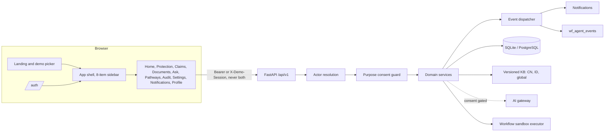

## 3. Authentication architecture

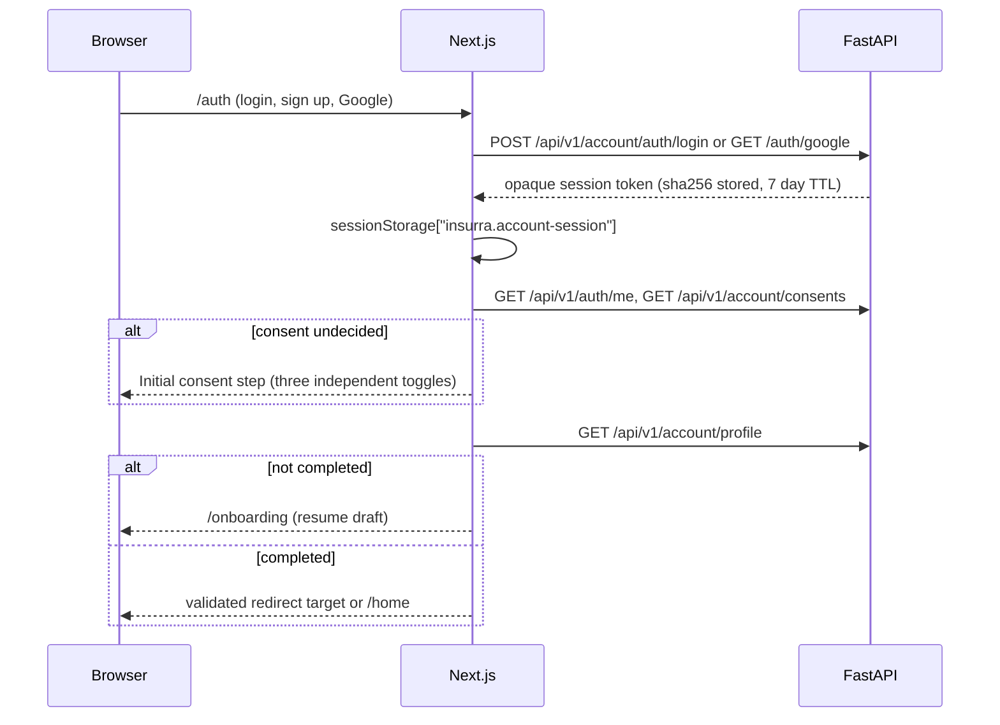

- Google OAuth: PKCE S256 and state in short-lived httponly cookies, verified Google email required, fixed frontend redirect, application token delivered in URL fragment and removed immediately.
- Email/password: PBKDF2-SHA256 (310k). Verification and reset tokens stored as sha256 (planned, AD-15), verification expiry 48 h (planned). Unified 401 for unknown email and wrong password; lockout after 5 failures. Email delivery is not configured; the UI states this (AD-16).
- Logout revokes the server session and clears all client caches for that tab.

## 4. Demo session architecture

- `POST /api/v1/demo/sessions {persona_id}` accepts only template ids from `persona_templates` (`raka`, `sinta`). Token from `secrets.token_urlsafe(32)`, only sha256 stored, 24 h TTL.
- On creation the persona template is copied into per-session rows (`profiles`, `insurance_records`, `consents`, `purpose_consents`, `wf_*` claims/actions) with fresh UUIDs. Canonical fixture files are never written.
- Reset (planned): revoke the current session and create a new one for the same persona. End (planned): set `revoked_at`. Expired or revoked sessions fail resolution and are purged with cascade on later session creation.
- Every demo response surface shows a synthetic badge; sandbox results are labeled "Simulated sandbox".

## 5. Real account isolation

- Account-owned tables carry `account_id`; demo-owned tables carry `session_id`; shared workspace tables use `OwnerColumns` with check `(account_id IS NULL) <> (session_id IS NULL)`; workflow tables use `owner_kind` plus `owner_id` resolved by `workflow/owner.py`.
- Repositories filter by the resolved actor. Missing and foreign IDs both return 404.
- A request carrying both credentials is rejected (`AMBIGUOUS_ACTOR`) by every resolver, including legacy `ActiveSession` (planned).
- New accounts start with empty data. No persona data is copied into account tables.

## 6. Profile and onboarding data flow

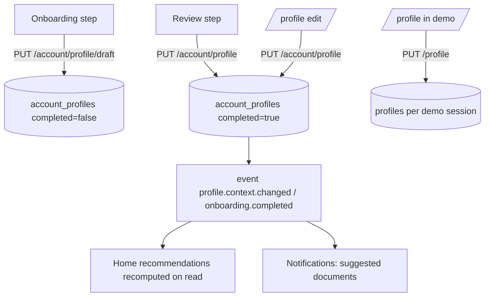

- One schema `ProfileData` for both stores; additive fields per AD-02.
- Country change rules from `docs/prd/COUNTRY_INTEGRATION.md` apply: omitted country-bound fields cleared, original policy and document countries untouched, mismatched assessments `NEEDS_VERIFICATION`.
- Profile setup, insurance declared, documents uploaded, fields extracted, fields reviewed and coverage verified are separate states. Onboarding completion never implies verified protection.

## 7. Public knowledge versus private user data

| Public knowledge (read-only, versioned) | Private data (owner-scoped) |
| --- | --- |
| `kb/{CN,ID}/*.json`, `kb/global/*`, catalog tables | Profiles, consents, preferences, documents, pages, fields, coverages, claims, actions, notifications, audit |
| Envelope: schema_version 1.5, version, source_url, checked_at, verification_status | Provenance: document id, page, field confidence, reviewer confirmation |
| Unknown facts stay null and UNVERIFIED | Missing never means excluded |

Active markets: `ACTIVE_KB_COUNTRIES=CN,ID` (planned). `kb/AU` stays on disk and is not loaded.

## 8. Shared data contracts

- `ProfileData` / `UserProfile` (profile), `AccountProfileState` (account wrapper), `UnifiedInsuranceRecord` (demo record), `AccountCoverage` and reviewed `AccountField` (account coverage evidence), `HomeSummary`, `CoverageNeed`, `PathwayComparison`, `AskAnswer` (Valen), workflow claim/action schemas (Joshua), `ApiError(code,message,details,request_id)`.
- New (planned): `UserContext`, `Notification`, `NotificationPage`, `UnreadCount`, `Preferences`, `ConnectedSource`, `AccountExport`, `DemoPersona` (extended), `DemoSessionReset`.

## 9. Event-driven workflow

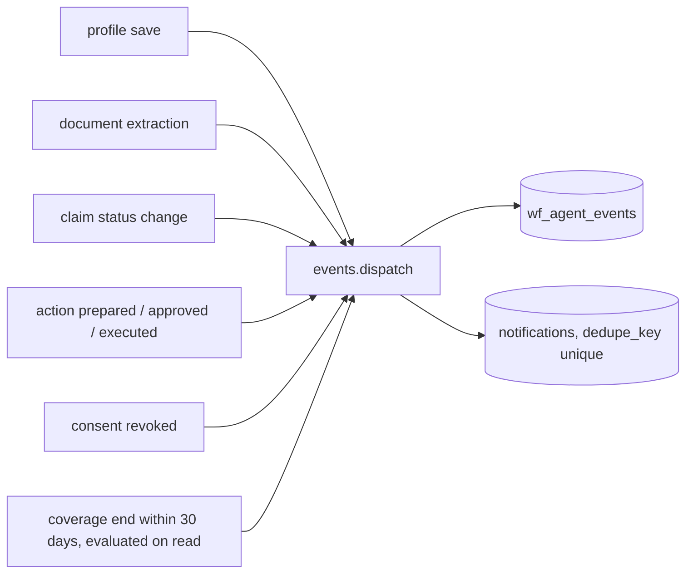

- `services/events.py` (planned) exposes `dispatch(db, actor, event_type, entity_ref, payload_meta)`. It runs in the same transaction as the producing change, writes an agent event and maps the event to zero or one notification via a static table. Payloads hold stable entity references and allow-listed metadata only.
- Duplicate events collapse through the unique `dedupe_key` (insert-or-ignore). Consumers re-check consent at execution time. No LLM calls in the dispatcher, so no loops.
- Event types: `profile.context.changed`, `onboarding.completed`, `document.uploaded`, `document.extraction.completed`, `document.field.confirmed`, `coverage.updated`, `coverage.assessment.completed`, `claim.created`, `claim.status.changed`, `action.prepared`, `action.approved`, `action.executed`, `reminder.due`, `consent.revoked`.

## 10. Notification architecture

- Table `notifications` (owner XOR), categories `ACTION_REQUIRED`, `CLAIMS`, `PROTECTION`, `SYSTEM`, priority `LOW|NORMAL|HIGH`, deep link restricted to in-app relative paths.
- Endpoints: list with filter (`all|unread|action_required|claims|protection|system`), unread count, mark read, mark all read.
- Reminder notifications are generated on list/count calls from owned coverage end dates with keys like `reminder:{coverage_id}:{end_date}` so they are deterministic and idempotent.
- Preferences in `user_preferences` suppress creation of opted-out categories (security and consent notices cannot be disabled).
- Content rule: titles and bodies never include medical details, document values or amounts.
- Demo sessions get notifications from the same dispatcher when their seeded claims and actions are created, so they are real events within the session and carry the synthetic flag through the session.

## 11. Consent and privacy enforcement

- Purposes `process_documents`, `external_ai`, `retention` default false; checked from current database rows on each protected call (`require_grants`, `require_account_purposes`). AI-capable routes require the first two.
- Revocation purges derived chunks and chat history (existing), dispatches `consent.revoked`, and pending AI work re-checks grants before execution.
- Privacy management (inventory, export, delete, consent changes) never requires a processing grant.
- Deletion: profile, documents, pages, fields, coverages, family, workspace state, notifications, preferences and owner-scoped workflow rows removed; consents revoked; account and redacted audit retained.

## 12. Database entities and relationships

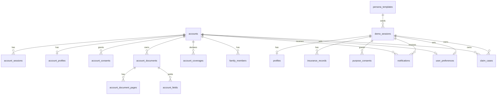

Workflow tables (`wf_claim_cases`, `wf_actions`, `wf_action_approvals`, `wf_execution_receipts`, `wf_sandbox_claims`, `wf_reminders`, `wf_agent_events`, `wf_audit_logs`) are owned via `owner_kind` plus `owner_id`.

## 13. Agent tool boundaries

- Read tools: profile context, owned coverages, reviewed fields, KB resources. Never cross-owner.
- Write tools: claim drafts, action drafts, notifications, audit. All owner-scoped.
- Consequential tools (submission, external send): require a persisted approval bound to the canonical payload hash; execution only in the sandbox (`workflow/sandbox.py`) or as user-downloaded artifacts (ICS, mailto, PDF). Results labeled simulated.
- Document text, OCR output and retrieved web content are untrusted data; injection patterns flagged; never executed as instructions.

## 14. Authorization and audit architecture

- Actor resolution, then consent, then owned object lookup, then action.
- Audit: `account_audit_events`, `audit_events` (demo), `wf_audit_logs`. Metadata is an allow-list; no raw tokens, passwords, questions or document values.

## 15. Error and retry behavior

- All errors use `ApiError(code,message,details,request_id)` with `Cache-Control: no-store`.
- 401 unauthenticated, 403 consent missing (`CONSENT_REQUIRED`), 404 missing or foreign, 409 conflict or idempotency mismatch, 422 validation or `AMBIGUOUS_ACTOR`, 429 throttled, 501 unavailable feature.
- Consequential POSTs accept `Idempotency-Key`. Event dispatch is idempotent through dedupe keys. Frontend shows retry controls on network errors and never shows success toasts for failed requests.

---

# Part B: Agentic architecture diagrams (proposed, 2026-10-19)

Part A above is unchanged. Details: `docs/AGENTIC_AI_ARCHITECTURE.md`, `docs/INTEGRATION_CONTRACTS.md`.

## B1. Overall system

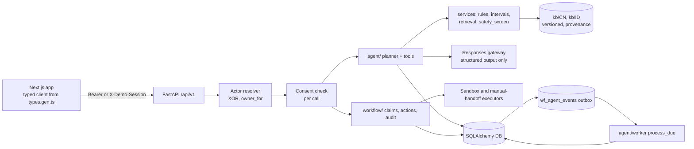

## B2. Agent execution flow

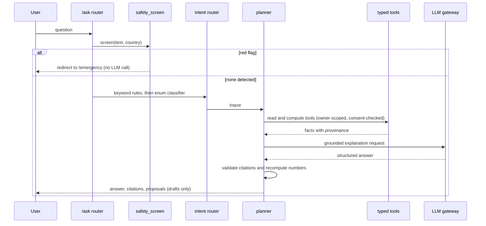

## B3. Claim state machine

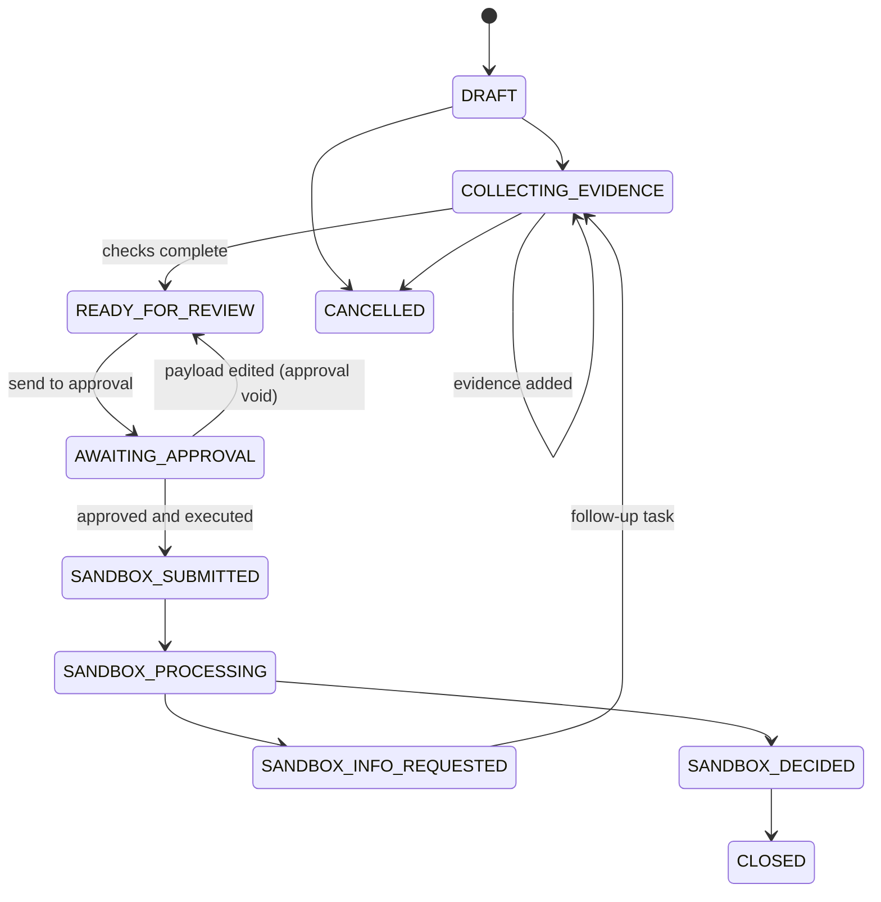

Sandbox states are labeled sandbox in the UI. No real insurer status exists.

## B4. Event-driven orchestration

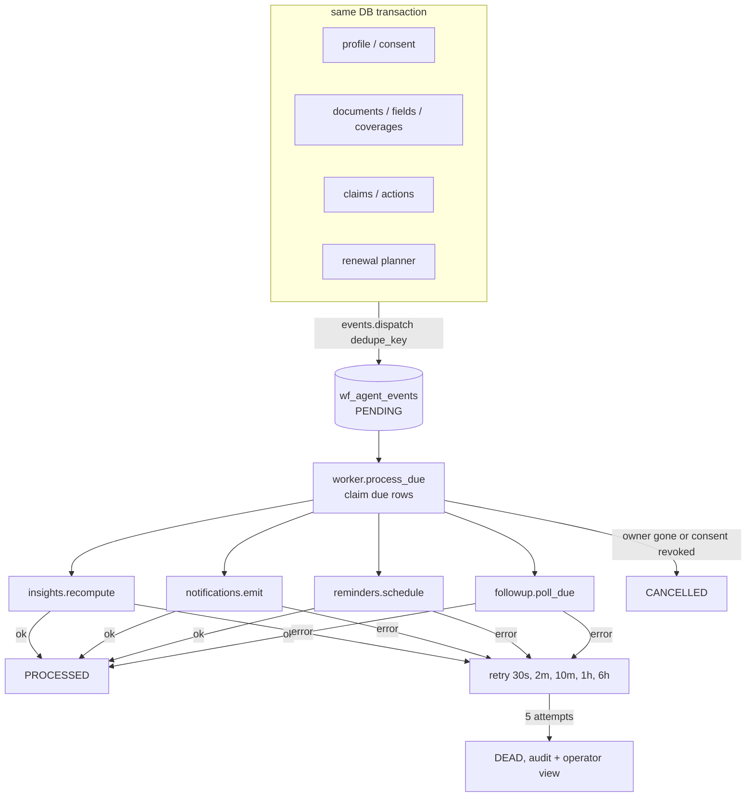

## B5. Demo versus account isolation

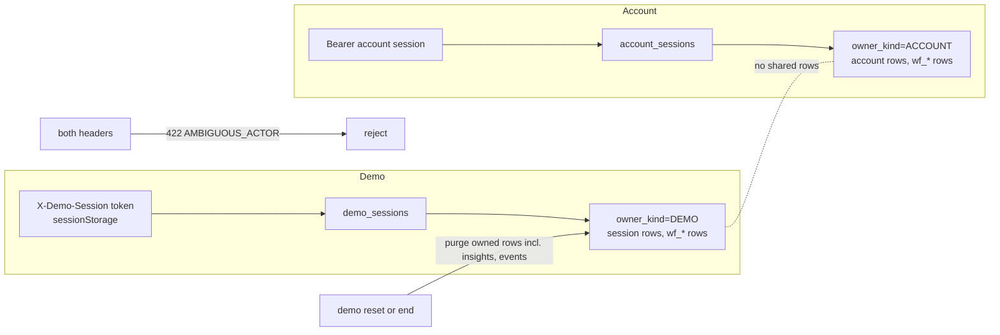

## B6. Cross-team dependencies

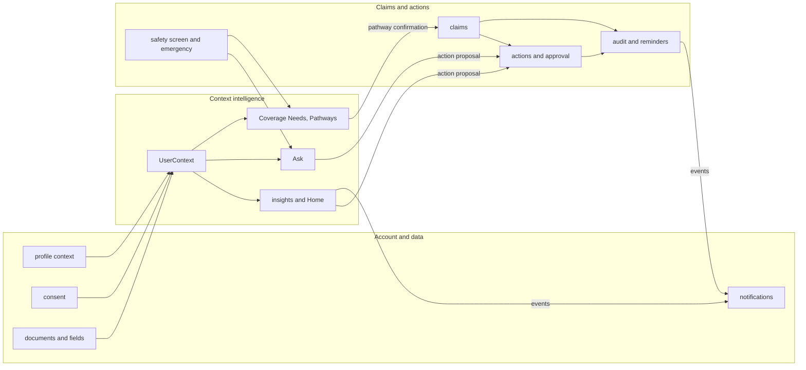
