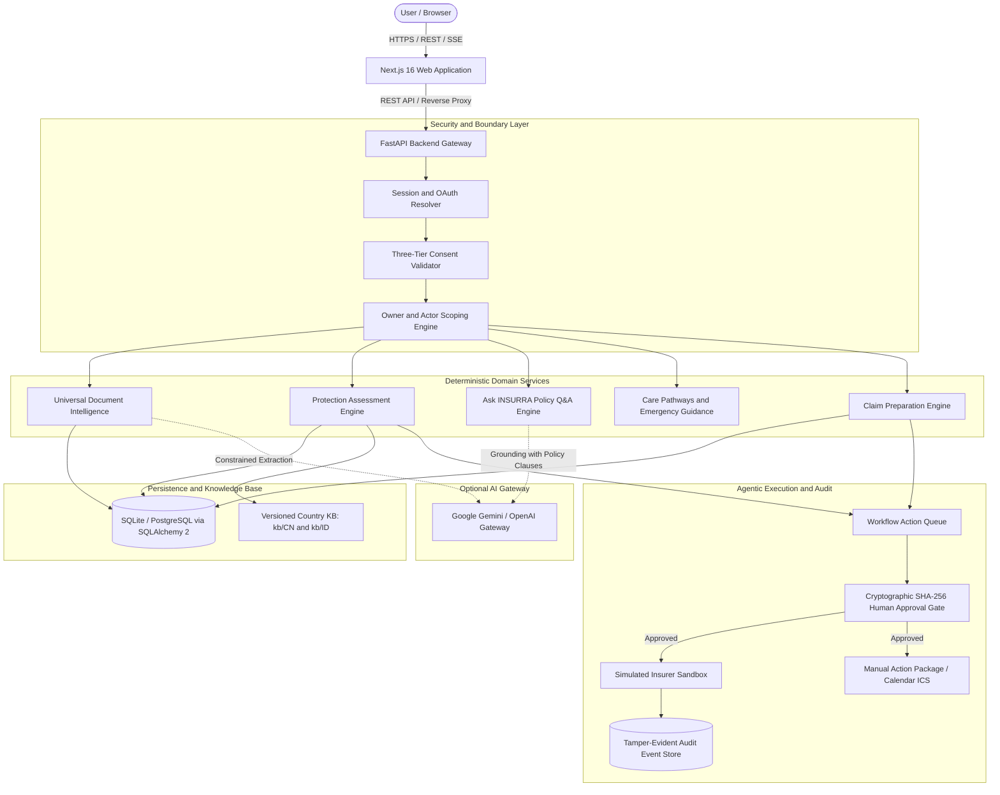

# INSURRA

> AI Insurance Decision and Action Companion for Cross-Border Healthcare

INSURRA helps policyholders understand unfamiliar health insurance policies, verify coverage, navigate care pathways, and prepare claims safely. It is specifically designed for international students, migrant workers, and expatriates navigating healthcare systems in mainland China (CN) and Indonesia (ID).

Unlike standard chatbots that guess policy rules, INSURRA combines generative AI with deterministic logic. All policy math, interval calculations, and emergency guidelines are computed in deterministic Python code, preventing AI hallucinations in critical financial and healthcare decisions.

This repository represents the official competition submission for the **Shenzhen FinTechathon 2026 (International Track)**.

---

## Team Information

- **Team Name:** WGTC
- **Institution:** Universitas Indonesia
- **Team Members:**
  - Jasmine Rakhaila
  - Anggun Sasmitha
  - Regina Aruan
  - Valentino Kim
  - Joshua Hans Vito

---

## Core Features

| Feature | Status | Description |
|---|---|---|
| **Authentication & Onboarding** | Implemented | Google OAuth 2.0 PKCE, PBKDF2 email/password authentication, and isolated guest demo access. |
| **Universal Document Intelligence** | Implemented | Multi-tier extraction (PyPDF, pdftotext, Tesseract OCR) with structured Pydantic schema validation. |
| **My Protection & Coverage Assessment** | Implemented | Deterministic interval math identifying coverage gaps, active benefits, and unverified terms. |
| **Policy Wallet** | Implemented | Centralized storage for policy terms, deductibles, co-pays, hospital tiers, and coverage dates. |
| **Ask INSURRA** | Implemented | Evidence-grounded policy Q&A with direct clause citations and Server-Sent Events (SSE) streaming. |
| **Care Pathways & Emergency** | Implemented | Red-flag medical symptom escalation and official emergency contacts (120/110/119 for CN, 112/119 for ID). |
| **Claims Center** | Implemented | Claim case tracking, timeline reconstruction, and factual checklist verification. |
| **Claim Readiness & Preparation** | Implemented | Automated evidence validation and structured claim draft generation. |
| **Renewal & Anti-Lapse** | Implemented | Anti-lapse alert triggers and renewal reminder generation. |
| **Action Queue & Human Approval** | Implemented | Cryptographic SHA-256 approval gate ensuring users explicitly approve any proposed action. |
| **Activity & Tamper-Evident Audit** | Implemented | Comprehensive audit log with HMAC SHA-256 signatures for every executed action. |
| **Direct Insurer Submission** | Sandbox Only | Simulated sandbox execution. Real insurer APIs return 501 until official partnerships are certified. |

---

## Architecture Overview



For detailed architectural diagrams and data flows, see [docs/ARCHITECTURE.md](docs/ARCHITECTURE.md).

---

## Technology Stack

The repository uses pinned, reproducible dependencies:

- **Frontend:**
  - Next.js 16.4.2 (App Router, webpack mode)
  - React 19.3.1
  - TypeScript 5.9.3 (strict mode)
  - Tailwind CSS 4.3.3
  - Lucide Icons & Radix UI primitives
  - Native browser fetch with typed API client
- **Backend:**
  - Python 3.11+ (verified up to Python 3.15)
  - uv 0.13.1 (package and dependency manager)
  - FastAPI 0.143.3
  - Pydantic v2 (2.14.1) & Pydantic Settings
  - SQLAlchemy 2.1.5 & Alembic 1.20.0
  - Uvicorn (ASGI web server)
- **AI Gateway:**
  - Google Gemini API (`gemini-3.5-flash-lite` default)
  - OpenAI API compatibility seam via OpenAI Python SDK
- **Testing & Quality Assurance:**
  - Pytest 9.1.1 (backend test runner)
  - Playwright 1.64.1 (frontend client and browser tests)
  - Ruff (Python linter and code formatter)
  - openapi-typescript 7.13.0 (typed frontend contract generation)

---

## Prerequisites

Before running the project locally, ensure you have:
1. Python 3.11 or higher.
2. Node.js 20.9.0 or higher (Node 22 or 24 recommended).
3. npm (bundled with Node.js).
4. `uv` Python package manager (optional; `make setup` installs a local copy if absent).
5. GNU Make.
6. Optional: Google Gemini API key (needed only for live AI features; demo mode works completely offline with zero paid API keys).

---

## Quick Start Guide

Follow these verified steps to run the application locally:

### 1. Clone the Repository
```bash
git clone <REPOSITORY_URL>
cd INSURRA
```

### 2. Configure Environment Variables
Copy the template environment file:
```bash
cp .env.example .env
```
For demo and testing purposes, the default values in `.env.example` work out of the box with zero external configuration.

### 3. Install Dependencies
Run the unified setup command to install both backend and frontend dependencies:
```bash
make setup
```
This runs `uv sync --locked` for the backend and `npm ci` for the frontend.

### 4. Run Database Migrations
Initialize the database schema using Alembic:
```bash
make migrate
```

### 5. Load Synthetic Demo Data
Seed the pre-configured synthetic personas (Raka and Sinta) and catalog templates:
```bash
make seed
```

### 6. Start the Application
You can run both services together or in separate terminal tabs:

**Option A: Unified start (both services in one terminal):**
```bash
make dev
```

**Option B: Separate terminals:**
- Terminal 1 (Backend API on port 8000):
  ```bash
  make dev-backend
  ```
- Terminal 2 (Frontend Web on port 3000):
  ```bash
  make dev-frontend
  ```

### 7. Access the Application
- Open your browser at: `http://localhost:3000`
- Access the API documentation at: `http://localhost:8000/docs`

---

## Environment Variables

All settings are configured via `.env` at the root of the repository:

| Variable | Required | Default | Consumed By | Description |
|---|---|---|---|---|
| `DATABASE_URL` | Yes | `sqlite:///./dev.db` | Backend | Database connection URL (SQLite locally, PostgreSQL in production). |
| `FRONTEND_ORIGIN` | Yes | `http://localhost:3000` | Backend | CORS allowed origin. Must be an explicit URL. |
| `NEXT_PUBLIC_API_BASE_URL` | Yes | `http://localhost:8000` | Frontend | Base URL of the API gateway called by the frontend. |
| `AI_PROVIDER` | No | `gemini` | Backend | AI provider selection: `gemini` or `openai`. |
| `GEMINI_API_KEY` | Optional | *Empty* | Backend | API key for Google Gemini. Not required for synthetic demo. |
| `GEMINI_MODEL` | No | `gemini-3.5-flash-lite` | Backend | Primary Gemini model for extraction and Q&A. |
| `ACTIVE_KB_COUNTRIES` | No | `CN,ID` | Backend | Comma-separated country codes enabled in the knowledge base. |
| `ENVIRONMENT` | No | `development` | Both | Application environment: `development` or `production`. |
| `SESSION_TTL_HOURS` | No | `24` | Backend | Time-to-live for ephemeral demo sessions. |
| `ACCOUNT_SESSION_TTL_DAYS`| No | `7` | Backend | Time-to-live for authenticated account sessions. |
| `SESSION_SECRET` | Optional | *Empty* | Backend | Secret key used for signing receipts and hashing tokens. |
| `GOOGLE_CLIENT_ID` | Optional | *Empty* | Backend | Google OAuth Client ID for live social login. |
| `GOOGLE_CLIENT_SECRET` | Optional | *Empty* | Backend | Google OAuth Client Secret. |
| `GOOGLE_REDIRECT_URI` | Optional | `http://localhost:8000/auth/google/callback` | Backend | OAuth callback redirect URI. |

---

## Demo Personas and Synthetic Workflows

INSURRA provides two completely synthetic, pre-seeded personas. No real personal data or active insurance documents are used.

### Persona 1: Raka (International Student in Melbourne)
- Profile: Indonesian student living in Melbourne, Australia.
- Insurance Context: Synthetic Overseas Student Health Cover (OSHC) with Allianz Care.
- Coverage Gap Calculation: Raka has a calculated **76-day potential coverage gap** (16 April to 30 June 2027). Because rules are unverified, the system marks this as `NEEDS_VERIFICATION`.
- Sample Workflow: Select Raka on the home page, inspect the coverage gap alert, explore Care Pathways, and review suggested actions in the Action Queue.

### Persona 2: Sinta (Domestic Worker in Jakarta)
- Profile: Indonesian worker employed in Jakarta, Indonesia.
- Insurance Context: Dual coverage under BPJS Kesehatan and a private corporate group policy.
- Coverage Assessment: Sinta has continuous active domestic coverage; status is `NOT_APPLICABLE` (no gap).
- Sample Workflow: Select Sinta, ask policy questions regarding dental and inpatient benefits, and review the factual emergency guidance for Jakarta.

### Session Isolation
- Each demo session receives an ephemeral token via the `X-Demo-Session` HTTP header.
- Demo tokens are hashed at rest using SHA-256 and expire after 24 hours.
- Demo sessions cannot access data belonging to registered accounts or other demo sessions.

---

## Agentic AI Workflow

INSURRA follows a strict, human-supervised action pipeline:

1. **Document Ingestion:** The user uploads a policy PDF or medical invoice.
2. **Fact Extraction:** Text is extracted via PyPDF or OCR, then validated into structured Pydantic schemas.
3. **Protection Assessment:** Deterministic algorithms calculate inclusive date ranges, deductibles, and benefits.
4. **Action Proposal:** If an issue is identified, the system creates a proposed action with status `AWAITING_APPROVAL`.
5. **Human Approval Gate:** The user reviews the exact action details. The approval request is cryptographically bound to the SHA-256 digest of the payload.
6. **Sandbox Execution & Receipt:** Once approved, the action is simulated in an isolated sandbox, and an HMAC SHA-256 receipt is recorded in the audit log.

---

## Running Tests and Quality Checks

INSURRA includes over 500 automated tests to guarantee system stability and contract conformance.

### 1. Backend Automated Tests (Pytest)
```bash
make test
```
- Total test items: 533
- Verified result: 532 passed, 1 skipped (live Gemini network test skipped in offline mode)
- Covers: dual-session isolation, three-tier consent revocation, cryptographic approval hashing, deterministic interval math, and Alembic migrations.

### 2. Frontend Client Unit Tests (Playwright)
```bash
make test-client
```
- Total tests: 14 passed
- Covers: typed HTTP client, Server-Sent Events stream handling, 204 no-content handling, and open-redirect defenses.

### 3. Full Repository Quality Gate
```bash
make check
```
- Runs Ruff linter and code format check.
- Runs frontend ESLint, TypeScript strict type check, and Next.js production build.

### 4. Contract Drift Verification
```bash
make check-contracts
```
- Validates that `backend/openapi.json` matches `frontend/src/lib/api/types.gen.ts`.
- Validates endpoint coverage against `docs/prd/API_CONTRACT_MANIFEST.json`.

For a complete testing breakdown, see [docs/TESTING.md](docs/TESTING.md).

---

## Deployment Guide

INSURRA can be deployed using Docker, Railway (backend), Vercel (frontend), and managed PostgreSQL.

For full step-by-step production setup, CORS configuration, database migrations, and health checks, see [docs/DEPLOYMENT.md](docs/DEPLOYMENT.md).

---

## Security and Privacy Principles

- **Three-Tier Purpose Consent:** INSURRA enforces independent database flags for `process_documents`, `external_ai`, and `retention`. External AI calls are immediately blocked if consent is revoked.
- **Zero Generative Arithmetic:** All financial numbers, benefit limits, and calendar dates are calculated using deterministic Python algorithms.
- **Fail Closed Safety Screening:** If emergency guidance or symptom rules for a country are unverified, the system returns `TRIAGE_UNAVAILABLE` rather than guessing medical advice.
- **Tamper-Evident Approvals:** Human approval requests require an exact `expected_payload_hash`. Modifying the action payload invalidates the approval.
- **Dual Session Scoping:** Demo sessions and authenticated user accounts are kept strictly separate. Cross-tenant access attempts return `404 NOT_FOUND` to prevent enumeration.

---

## Known Limitations

- **Country Scope:** China (`CN`) and Indonesia (`ID`) are fully active in the knowledge base. Australia (`AU`) drafts remain on disk but inactive in production.
- **Insurer Direct Integrations:** Direct insurer claim submission and policy purchasing are currently simulated in sandbox mode. Production integrations will require certified insurer API keys.
- **OCR Dependencies:** Image-based OCR requires system-level Tesseract binaries. PDFs containing selectable digital text are processed directly with PyPDF without OCR.

---

## Submission Checklist

For the Shenzhen FinTechathon 2026 evaluation checklist and verification record, see [docs/submission/04_Source_Code_Submission_Checklist.md](docs/submission/04_Source_Code_Submission_Checklist.md).

---

## License

This software and documentation are submitted for evaluation in the Shenzhen FinTechathon 2026. All rights reserved by Team WGTC (Universitas Indonesia).
