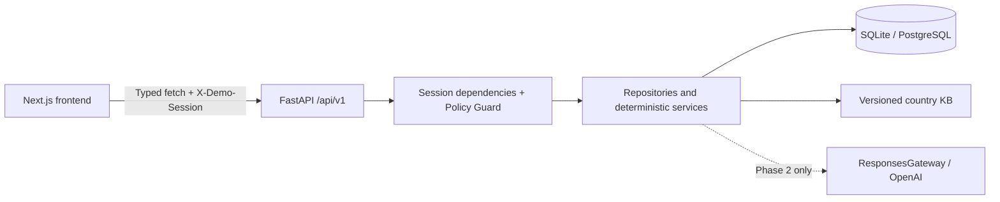

# AI Insurance Companion

## Overview

Insurra helps Indonesian speakers understand unfamiliar health insurance systems. The intended product connects document evidence, policy questions, coverage checks, care pathways, and claim preparation in one workspace.

This repository implements **Phase 1: Foundation & Contracts** of a 48-hour hackathon MVP. Its working demo uses entirely synthetic data for Raka, a student in Melbourne, and Sinta, a new employee in Jakarta. No real policy documents, personal identifiers, provider integrations, or paid credentials are required.

## Hackathon Scope

Phase 1 provides stable interfaces for three development tracks: frontend; Document Intelligence and AI; rules and claims. Future features have typed OpenAPI contracts and return explicit `501 NOT_IMPLEMENTED`, after session and consent checks. Nothing is deployed.

## Features

Implemented:

- Backend-backed, isolated demo sessions with opaque tokens, hashed at rest, expiring after 24 hours.
- Explicit consent, false by default; grant/revoke controls and server-side enforcement.
- Session-scoped profile read/update, seeded insurance records, and filtered audit history.
- Versioned, validated AU/ID country configuration and idempotent fixture seeding.
- Deterministic, inclusive interval calculation: Raka has a **potential 76-day gap**, 16 April–30 June 2027. Because rules/policies are unverified, status is `NEEDS_VERIFICATION`, not a legal finding. Sinta returns `NOT_APPLICABLE`.
- Responsive Indonesian application shell, persona selection, onboarding, dashboard, document metadata and audit pages.
- Generated TypeScript contracts, typed fetch client, migrations, automated tests, linting and build commands.

Planned: document upload/storage/extraction, completeness and coverage-needs checks, cited policy Q&A, care comparison, claim drafts and action approval/execution. Their pages honestly show the next-phase boundary.

## Tech Stack

- Frontend: Next.js 16 App Router, React 19, TypeScript 5 strict mode, Tailwind CSS 4, initialized shadcn/ui Radix Button, Lucide, native fetch, React Context.
- Backend: Python 3.11+, uv, FastAPI, Pydantic v2/Settings, SQLAlchemy 2, Alembic, Uvicorn, pytest, httpx, Ruff.
- Persistence: SQLite locally; PostgreSQL through psycopg and `DATABASE_URL`. Supabase PostgreSQL is a future deployment option; Storage is not integrated.
- AI seam: OpenAI Python SDK, Responses API and Pydantic Structured Outputs. Models default to `gpt-6.1-sol` and `gpt-6-luna`, both configurable. No Phase 1 route calls AI; account/model availability is not tested.
- Contracts: OpenAPI → openapi-typescript. Browser smoke tests: Playwright/Chromium.
- Deployment targets only: Vercel frontend and Railway backend. No deployment configuration or deployment is performed.

Verified core versions: Next.js 16.4.2, React 19.3.1, TypeScript 5.9.3, Tailwind 4.3.3, Python 3.11.15, FastAPI 0.143.3, Pydantic 2.14.1, SQLAlchemy 2.1.5, Alembic 1.20.0, OpenAI SDK 2.54.0 and uv 0.13.1.

Exact dependency versions are pinned by `backend/uv.lock` and `frontend/package-lock.json`.

## Architecture



The backend owns domain contracts, calculations, consent and ownership. The frontend owns presentation and explicitly displays uncertainty. Requests use a shared `ApiError` envelope, request IDs, and `Cache-Control: no-store`.

## Project Structure

```text
.
├── frontend/
│   ├── src/app/             # Landing, onboarding, dashboard, documents,
│   │                       # ask-policy, coverage, care, claims, audit
│   ├── src/components/      # Application shell and reusable UI
│   ├── src/lib/api/         # Typed client + generated types.gen.ts
│   ├── src/lib/session.tsx  # Per-tab demo session lifecycle
│   └── tests/               # Desktop/mobile end-to-end demo flow
├── backend/
│   ├── app/api/v1/          # Functional endpoints and 501 skeletons
│   ├── app/schemas/         # Pydantic domain/API/KB contracts
│   ├── app/models/          # SQLAlchemy persistence
│   ├── app/repositories/    # Session-scoped data access
│   ├── app/services/        # Rules, KB, guards, audit, AI extension seam
│   ├── app/seeds/           # Idempotent synthetic templates
│   ├── app/tests/           # API, rules, guard, migration/seed tests
│   ├── migrations/          # Explicit Alembic revision history
│   └── openapi.json         # Generated API snapshot
├── kb/{AU,ID}/              # Versioned configuration, never legal advice
├── fixtures/{raka,sinta}/   # Synthetic profiles, records, metadata, placeholders
├── scripts/                # Offline OpenAPI export
├── AGENTS.md
├── .env.example
└── Makefile
```

## Prerequisites

Python 3.11+, Node.js 20.9+ (verified with Node 24.21.0), npm, and `make`. An installed `uv` is preferred; `make setup` bootstraps a repository-local uv into ignored `.tools/` when absent. Initial package/browser downloads require internet access. No API key or external database is needed.

## Quick Start

From a checkout of this repository:

```sh
cd /path/to/insurra
cp .env.example .env
make setup
make migrate
make seed
```

In one terminal:

```sh
make dev-backend
```

In another:

```sh
make dev-frontend
```

Open **http://localhost:3000**. Choose Raka or Sinta, grant consent (or explicitly view seeded data without it), and visit the dashboard. Consent can be revoked under Privacy & Consent; audit history records changes. Selecting a different persona creates a fresh session and clears the previous frontend state.

Backend: **http://localhost:8000**. Interactive API docs: **http://localhost:8000/docs**. Verify:

```sh
make test
make check
make generate-types
```

Next uses Webpack for dev/build to avoid Turbopack worker-port restrictions in some local sandboxes. Fonts use a local system stack; builds need no Google Fonts network access.

## Environment Variables

Copy the root `.env.example` to `.env`. Pydantic and Next's configuration read this file; exported environment variables take precedence. Only the public API base URL is referenced in browser code.

| Variable | Local default / purpose |
| --- | --- |
| `DATABASE_URL` | `sqlite:///./dev.db`; resolves in `backend/` with Make commands |
| `FRONTEND_ORIGIN` | `http://localhost:3000`; one explicit CORS origin, wildcard rejected |
| `NEXT_PUBLIC_API_BASE_URL` | `http://localhost:8000`; browser-visible backend URL |
| `OPENAI_API_KEY` | Empty; optional server-only Phase 2 credential |
| `OPENAI_MODEL` | `gpt-6.1-sol`; configurable primary model |
| `OPENAI_FAST_MODEL` | `gpt-6-luna`; configurable lightweight model |
| `ENVIRONMENT` | `development` |
| `SESSION_TTL_HOURS` | Optional, defaults to `24` |
| `KB_ROOT` | Optional absolute override for the `kb/` folder |

Never prefix secrets with `NEXT_PUBLIC_`. In future hosted builds, supply the public base URL at frontend build time and backend credentials through server environment configuration.

## Demo Personas

**All data and providers are synthetic.** Template UUIDs are replaced for every session, including policy and document references.

| Persona | Context | Seed record | Visa interval |
| --- | --- | --- | --- |
| Raka | Student, Melbourne, AU, abroad | OSHC category; coverage ends 2027-04-15; stay ends 2027-06-30 | Potential 76-day gap; needs verification |
| Sinta | Employee, Jakarta, ID, domestic | BPJS and employer insurance categories | Not applicable |

Benefit coverage stays `UNKNOWN`, amounts stay null, and policies remain `UNVERIFIED`. Text files explicitly identify themselves as synthetic placeholders, never actual policy clauses. Placeholder evidence has no invented page number and is not used as benefit evidence. Document hashes describe those actual fixture bytes. Seeding persists validated persona templates, not consented sessions; document metadata is included in the seeded unified record.

## API Documentation

OpenAPI UI: `/docs`; machine schema: `/openapi.json`; health: `/health`. Domain endpoints use `/api/v1` and `X-Demo-Session`. Session creation returns the token once; subsequent responses do not return it.

| Method | Path | Behavior |
| --- | --- | --- |
| GET | `/health` | Health and application version |
| GET | `/api/v1/countries` | Validated manifests discovered from KB folders |
| GET | `/api/v1/demo/personas` | Available seeded synthetic personas |
| POST | `/api/v1/demo/sessions` | `{ "persona_id": "raka" }` or `"sinta"`; 201 and opaque token |
| GET | `/api/v1/demo/sessions/me` | Current session, excluding token |
| GET / PUT | `/api/v1/consent` | Read/update `{ "processing_consent": true }` |
| GET / PUT | `/api/v1/profile` | Read/update current profile; IDs/timestamps cannot be overwritten |
| GET | `/api/v1/insurance/record` | Session-owned seeded insurance record |
| GET | `/api/v1/assessments/visa-gap` | Deterministic calculation; audit event |
| GET | `/api/v1/audit?event_type=CONSENT_GRANTED` | Session-scoped events; optional filter |

Stable future contracts return **501** with `ApiError` for valid, consented requests:

- GET `/documents`, POST `/documents/upload` (multipart `file`, optional `document_type`).
- GET `/assessments/completeness`, GET `/assessments/coverage-needs`.
- POST `/chat/ask` (`question`), POST `/care/compare` (`symptoms`, optional `service_type`, `city`).
- POST `/claims/draft` (`selected_pathway_code`).
- GET `/actions`, POST `/actions/{action_id}/approve`, POST `/actions/{action_id}/reject`.

The future paths above also have the `/api/v1` prefix. Invalid/missing sessions return 401; protected features without consent return 403; invalid requests return 422. No skeleton returns fake success or persists an action. Error fields: `code`, `message`, nullable `details`, `request_id`. Validation errors omit raw submitted values.

## Database & Migrations

`make migrate` applies the explicit initial Alembic revision. Startup does not create tables automatically. `make seed` inserts the two validated templates if absent and leaves existing sessions untouched; running it twice inserts zero additional templates. To change template content later, add a deliberate seed/version migration rather than overwriting active session data.

Tables: `demo_sessions`, `profiles`, `consents`, `insurance_records`, `audit_events`, `persona_templates`. JSON payloads are validated at application boundaries; UUID and JSON columns use portable SQLAlchemy types. SQLite foreign keys are enabled. `postgres://` and `postgresql://` URLs normalize to psycopg in online mode; `postgresql+psycopg://` is also accepted. For Supabase use an appropriate PostgreSQL connection string and SSL configuration in the server environment. No live PostgreSQL/Supabase instance was required or tested.

## Country Knowledge Base

Each `kb/{ISO_CODE}/` has `manifest.json`, `rules.json`, `coverage_needs.json`, `pathways.json`, `glossary.json`. The loader validates every file and discovers countries from manifests. Add another folder with the same contracts to add a country; no engine country branches are needed. Rule applicability, policy types, and date field selection are configuration.

Seed rules are **UNVERIFIED**: `checked_at` and `source_url` are null, manifest sources are empty. No regulatory verification is claimed. Emergency routing has an explicitly unverified placeholder and no asserted telephone number; care routes stay disabled until reviewed. Before activating such guidance, check authoritative sources, add real URLs and review dates, and validate requirements with a qualified reviewer.

All interval endpoints are inclusive. The engine unions matching policies, clips them to arrival through visa expiry, then counts each uncovered calendar day once. Missing dates/context return `NEEDS_VERIFICATION` with null day counts. Invalid ranges fail Pydantic validation. Money is a decimal string; no float calculations or currency conversions occur.

## Consent & Security

This is **demo authentication, not production authentication**. Random 256-bit bearer tokens are hashed with SHA-256 in the database, sent in `X-Demo-Session`, and stored only in per-tab `sessionStorage` by the UI. Anyone possessing a token can access that synthetic session until expiry. There is no account login, token rotation, logout/revocation endpoint, rate limiting, cleanup scheduler, or protection against an XSS-compromised browser. Switching personas clears the tab's token and displayed data; the old server session remains until expiry. Use synthetic data only.

Consent is false by default, checked from the database on every protected request, and revocation blocks subsequent protected calls. Seeded profile/record reads and deterministic date assessments do not require processing consent. Consent never authorizes real submissions. All approval/execution routes remain unimplemented; future execution must resolve server-owned approval state and ownership, not trust client-provided status.

Audit metadata uses an allow-list of operational values; raw tokens, questions, document content and identifiers are excluded. Request IDs are generated by the server. CORS uses an explicit origin. Production authentication, medical triage, injection detection and full page/citation verification are not complete; guard extension points fail closed.

## Development Commands

| Command | Purpose |
| --- | --- |
| `make setup` | Install locked Python/npm dependencies; bootstrap uv if needed |
| `make migrate` | Apply Alembic migrations |
| `make seed` | Idempotently seed synthetic templates |
| `make dev-backend` | FastAPI reload server at localhost:8000 |
| `make dev-frontend` | Next.js development server at localhost:3000 |
| `make test` | Backend tests, isolated migrated SQLite DBs |
| `make check` | Ruff check/format, ESLint, strict TypeScript, production build |
| `make generate-types` | Export Python OpenAPI then generate TypeScript types |

## Testing

Verified on 17 October 2026: **48 backend tests passed; 2 Playwright flows passed (desktop and mobile); Ruff, ESLint, TypeScript and production build passed.** Clean SQLite migrations and repeat seeding passed; PostgreSQL migration SQL compiled offline.

`make test` covers health/docs, country discovery/parsing, session creation/expiry, token hashing, isolation including repeated personas, consent/revocation, seeded records, deterministic gaps, missing/invalid dates, multiple coverage intervals, new-country configuration, guard validation, audit filtering/redaction, error shape, CORS, persistence across restart, OpenAPI snapshot drift, and mocked Responses integration. Tests require no OpenAI key or live AI call.

For browser tests, with ports 3000/8000 available:

```sh
cd frontend
npx playwright install chromium
npm run test:e2e
```

Playwright starts both local services, migrates/seeds a separate `.cache/e2e.db`, and runs the complete flow at desktop and mobile widths. It checks consent, Raka's backend result, reload persistence, documents, audit filtering, revocation, persona switching, Sinta isolation, runtime errors and horizontal overflow. When services already run, Playwright reuses them; use `CI=1` to require fresh servers. A custom `PLAYWRIGHT_BROWSERS_PATH` may be used in restricted environments.

## Known Limitations

- All Phase 2 routes are deliberate 501s; no actual uploads/storage, parsing/OCR, retrieval, chat, care advice, benefit assessment, claim draft or execution is enabled.
- Source validation utilities are conservative foundations, not completed citation/injection/triage safeguards.
- KB configuration is unchecked demo material, not regulatory guidance. No emergency-number or legal-compliance claims are made.
- No live PostgreSQL, Supabase, OpenAI model availability, deployment or real provider integration was tested.
- The installed Starlette/FastAPI test client emits a deprecation notice for httpx; tests still pass with the requested httpx dependency.
- `npm audit` reports five high findings in the development lint chain (`braces` → `micromatch` → `fast-glob` → Next ESLint tooling). No patched compatible `braces` version was available when installed. `npm audit --omit=dev` reports zero findings. Recheck upstream before publishing; do not blindly downgrade Next or use `audit fix --force`.

## Next Steps

1. **Frontend developer:** work against generated response types and real error states; connect feature pages when backend implementations replace their 501 boundaries.
2. **Document/AI developer:** implement upload/storage, extraction and original-page evidence behind the consent dependency. Return validated `ExtractedField` data, preserve currency, verify quotations, and only then wire `ResponsesGateway` to cited Q&A. See the official [Structured Outputs documentation](https://developers.openai.com/api/docs/guides/structured-outputs?api-mode=responses).
3. **Rules/claims developer:** verify/version KB sources, implement completeness/coverage-needs and reviewed pathways, then checklist/draft persistence. Persist proposed actions and enforce server-side approval before any future execution.

Phase 2 is not started automatically. Review `AGENTS.md` before extending the foundation.
