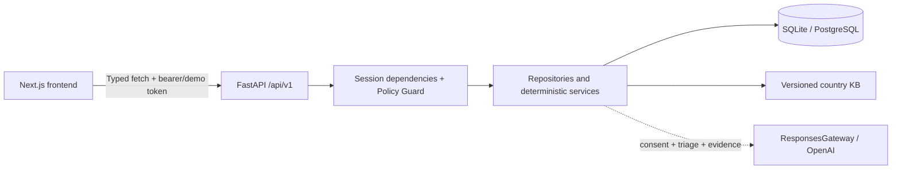

# AI Insurance Companion

## Overview

Insurra helps Indonesian speakers understand unfamiliar health insurance systems. The intended product connects document evidence, policy questions, coverage checks, care pathways, and claim preparation in one workspace.

This repository contains the shared foundation, existing authenticated account workspace, and Valen’s P0 implementation for `/home`, `/ask`, `/pathways` and `/coverage-needs`. Original Raka/Sinta fixtures remain explicitly synthetic. **P0 is not acceptance-complete:** shared triage/emergency data and downstream claim/action screens are unavailable. See [criterion results](docs/prd/VALEN_TRACEABILITY.md) and [verification](docs/agent-tasks/valen/VERIFICATION.md).

## Hackathon Scope

Valen’s authorized scope adds deterministic home recommendations, contextual protection needs, evidence-grounded policy Q&A, KB procedure comparisons and idempotent DRAFT case creation. It reuses current account/demo identities and normalized document fields. Shared triage, emergency UI, claim readiness, action approval/execution and Travel P1 remain deferred. No deployment, push or merge is performed.

## Features

Implemented:

- Backend-backed, isolated demo sessions with opaque tokens, hashed at rest, expiring after 24 hours.
- Independent `process_documents`, `external_ai`, and `retention` grants, false by default, with policy versions and grant/revocation timestamps. The existing demo control manages document-processing consent only; the canonical API manages all three purposes.
- Session-scoped profile read/update, optional PRD profile metadata, seeded insurance records, and filtered audit history with optional pagination. Demo sessions remain distinct from existing authenticated bearer accounts.
- Versioned, validated AU/ID country configuration and idempotent fixture seeding.
- Deterministic, inclusive interval calculation: Raka has a **potential 76-day gap**, 16 April–30 June 2027. Because rules/policies are unverified, status is `NEEDS_VERIFICATION`, not a legal finding. Sinta returns `NOT_APPLICABLE`.
- Responsive Indonesian application shell, persona selection, onboarding, dashboard, document metadata and audit pages.
- Existing public cover, Google/password account sign-in, account onboarding/documents/privacy, revocable bearer sessions, and the guest/demo path.
- Account/demo-aware home and protection-needs services; original record countries/currencies are preserved.
- Bounded multilingual clause retrieval, owned source pages, validated citations, deterministic numeric facts, consent-rechecked JSON/SSE Q&A, rate limits, cancellation and feedback.
- KB-driven non-medical pathway cards and verification questions; unknown tariffs stay null. Confirmed choices create one owned DRAFT case with a masked summary and audit event.
- Generated TypeScript/OpenAPI contracts, contract-drift checks, typed GET/POST/PUT/PATCH/DELETE and multipart/no-content/stream transport, additive migrations, scope/approval primitives, and automated verification.

Live Valen routes and UI are implemented, but Q&A/care fail closed with `TRIAGE_UNAVAILABLE` while shipped red flags are empty/unverified. Emergency numbers remain null. CI exercises reviewed synthetic triage/provider fixtures without promoting them to production facts. Source-backed answers need retained owned pages and reviewed coverage-linked fields; shipped extraction templates are empty. Claim detail/checklist, reminders/actions, triage HTTP endpoint and legacy foundation processing routes remain `501`. Existing account endpoints under `/account` are separate live interfaces.

## Tech Stack

- Frontend: Next.js 16 App Router, React 19, TypeScript 5 strict mode, Tailwind CSS 4, initialized shadcn/ui Radix Button, Lucide, native fetch, React Context.
- Backend: Python 3.11+, uv, FastAPI, Pydantic v2/Settings, SQLAlchemy 2, Alembic, Uvicorn, pytest, httpx, Ruff.
- Persistence: SQLite locally; PostgreSQL through psycopg and `DATABASE_URL`. Supabase PostgreSQL is a future deployment option; Storage is not integrated.
- AI seam: OpenAI Python SDK, Responses API and Pydantic Structured Outputs. Models default to `gpt-6.1-sol` and `gpt-6-luna`, both configurable. Q&A uses the existing gateway only after current consent, triage and source checks. Real account/model availability is not tested; CI never calls a provider.
- Contracts: OpenAPI → openapi-typescript. Browser smoke tests: Playwright/Chromium.
- Deployment targets only: Vercel frontend and Railway backend. No deployment configuration or deployment is performed.

Verified core versions: Next.js 16.4.2, React 19.3.1, TypeScript 5.9.3, Tailwind 4.3.3, Python 3.11.15, FastAPI 0.143.3, Pydantic 2.14.1, SQLAlchemy 2.1.5, Alembic 1.20.0, OpenAI SDK 2.54.0 and uv 0.13.1.

Exact dependency versions are pinned by `backend/uv.lock` and `frontend/package-lock.json`.

## Architecture



The backend owns domain contracts, calculations, consent and ownership. The frontend owns presentation and explicitly displays uncertainty. Requests use a shared `ApiError` envelope, request IDs, and `Cache-Control: no-store`.

## Project Structure

```text
.
├── frontend/
│   ├── src/app/             # Landing, onboarding, dashboard, documents,
│   │                       # ask-policy, coverage, care, claims, audit
│   ├── src/components/      # Application shell and reusable UI
│   ├── src/lib/api/         # Typed client + generated types.gen.ts
│   ├── src/lib/session.tsx  # Per-tab demo session lifecycle
│   └── tests/               # HTTP transport unit + desktop/mobile demo tests
├── backend/
│   ├── app/api/v1/          # Functional endpoints and 501 skeletons
│   ├── app/schemas/         # Pydantic domain/API/KB contracts
│   ├── app/models/          # SQLAlchemy persistence
│   ├── app/repositories/    # Session-scoped data access
│   ├── app/services/        # Rules, KB, guards, audit, AI extension seam
│   ├── app/seeds/           # Idempotent synthetic templates
│   ├── app/tests/           # API, rules, guard, migration/seed tests
│   ├── migrations/          # Explicit Alembic revision history
│   └── openapi.json         # Generated API snapshot
├── kb/{AU,ID}/              # Versioned configuration, never legal advice
├── fixtures/{raka,sinta}/   # Synthetic profiles, records, metadata, placeholders
├── scripts/                # Offline OpenAPI export and drift verification
├── docs/prd/               # Tracked traceability/routes/API/schema/decisions docs
│                           # Original local CSVs stay ignored and byte-identical
├── AGENTS.md
├── .env.example
└── Makefile
```

## Prerequisites

Python 3.11+, Node.js 20.9+ (verified with Node 24.21.0), npm, and `make`. An installed `uv` is preferred; `make setup` bootstraps a repository-local uv into ignored `.tools/` when absent. Initial package/browser downloads require internet access. Guest/demo and local account tests need no paid credentials. Google sign-in requires configured server-side OAuth credentials and callback URL. SQLite is supported locally.

## Quick Start

From a checkout of this repository:

```sh
cd /path/to/insurra
cp .env.example .env
make setup
make migrate
make seed
```

In one terminal:

```sh
make dev-backend
```

In another:

```sh
make dev-frontend
```

Open **http://localhost:3000**. Use the existing account login/onboarding or cover’s demo wizard. For Valen screens open `/home`; account consent is managed under `/settings/privacy`. Seeded demo records remain accessible without processing consent; protected processing requires explicit purpose grants. Selecting a different persona creates a fresh session and clears the previous frontend state.

Backend: **http://localhost:8000**. Interactive API docs: **http://localhost:8000/docs**. Verify:

```sh
make test
make check
make generate-types
make check-contracts
make test-client
```

Next uses Webpack for dev/build to avoid Turbopack worker-port restrictions in some local sandboxes. Fonts are installed locally through locked npm packages; builds need no Google Fonts network access.

## Environment Variables

Copy the root `.env.example` to `.env`. Pydantic and Next's configuration read this file; exported environment variables take precedence. Only the public API base URL is referenced in browser code.

| Variable | Local default / purpose |
| --- | --- |
| `DATABASE_URL` | `sqlite:///./dev.db`; resolves in `backend/` with Make commands |
| `FRONTEND_ORIGIN` | `http://localhost:3000`; one explicit CORS origin, wildcard rejected |
| `NEXT_PUBLIC_API_BASE_URL` | `http://localhost:8000`; browser-visible backend URL |
| `OPENAI_API_KEY` | Empty; optional server-only provider credential |
| `OPENAI_MODEL` | `gpt-6.1-sol`; configurable primary model |
| `OPENAI_FAST_MODEL` | `gpt-6-luna`; configurable lightweight model |
| `ENVIRONMENT` | `development` |
| `SESSION_TTL_HOURS` | Optional, defaults to `24` |
| `KB_ROOT` | Optional absolute override for the `kb/` folder |
| `GOOGLE_CLIENT_ID`, `GOOGLE_CLIENT_SECRET` | Server-only Google OAuth credentials |
| `GOOGLE_REDIRECT_URI` | Backend callback; locally `http://localhost:8000/auth/google/callback` |
| `FRONTEND_URL`, `BACKEND_URL` | Trusted application URLs used by OAuth redirects |
| `SESSION_SECRET` | Random server-only secret reserved for session hardening |
| `ACCOUNT_SESSION_TTL_DAYS` | Account session lifetime; defaults to `7` |

Never prefix secrets with `NEXT_PUBLIC_`. In hosted builds, supply the public base URL at frontend build time and backend credentials through server environment configuration. A production frontend without NEXT_PUBLIC_API_BASE_URL displays BACKEND_NOT_CONFIGURED instead of calling localhost. A frontend-only deployment cannot provide these backend features.

## Demo Personas

**All data and providers are synthetic.** Template UUIDs are replaced for every session, including policy and document references.

| Persona | Context | Seed record | Visa interval |
| --- | --- | --- | --- |
| Raka | Student, Melbourne, AU, abroad | OSHC category; coverage ends 2027-04-15; stay ends 2027-06-30 | Potential 76-day gap; needs verification |
| Sinta | Employee, Jakarta, ID, domestic | BPJS and employer insurance categories | Not applicable |

Benefit coverage stays `UNKNOWN`, amounts stay null, and policies remain `UNVERIFIED`. Text files explicitly identify themselves as synthetic placeholders, never actual policy clauses. Placeholder evidence has no invented page number and is not used as benefit evidence. Document hashes describe those actual fixture bytes. Seeding persists validated persona templates, not consented sessions; document metadata is included in the seeded unified record.

## API Documentation

OpenAPI UI: `/docs`; machine schema: `/openapi.json`; health: `/health`. Domain endpoints use `/api/v1`. Existing demo routes use `X-Demo-Session`; account routes use `Authorization: Bearer`. Valen routes accept either, rejecting ambiguous credentials. Session creation returns the token once; subsequent responses do not return it.

| Method | Path | Behavior |
| --- | --- | --- |
| GET | `/health` | Health and application version |
| GET | `/api/v1/countries` | Validated manifests discovered from KB folders |
| GET | `/api/v1/demo/personas` | Available seeded synthetic personas |
| POST | `/api/v1/demo/sessions` | `{ "persona_id": "raka" }` or `"sinta"`; 201 and opaque token |
| GET | `/api/v1/demo/sessions/me` | Current session, excluding token |
| GET / PUT | `/api/v1/consent` | Deprecated compatibility view/update of process_documents only |
| GET / POST | `/api/v1/consents` | Read all grants / explicitly update `{ "purpose": "external_ai", "granted": true, "policy_version": "1.5" }` |
| GET / PUT | `/api/v1/profile` | GET returns bare profile; PUT merges provided fields and returns `{profile,suggested_docs}`; IDs/timestamps cannot be overwritten |
| GET | `/api/v1/insurance/record` | Session-owned seeded insurance record |
| GET | `/api/v1/assessments/visa-gap` | Deterministic calculation; audit event |
| GET | `/api/v1/audit?event_type=CONSENT_GRANTED` | Scoped array; also supports type=consent, optional limit/offset and X-Total-Count |

Canonical Valen operations:

| Method/path under `/api/v1` | Behavior / purpose |
| --- | --- |
| GET `/home/summary` | Counts, context, configured recommendations and source availability; authenticated read |
| POST `/home/recommendations/decision` | Persist seven-day dismissal or confirmed handled state |
| GET `/coverage-needs` | Typed need list, current context and shared visa calculation; process_documents |
| POST `/ask` | Owned policy Q&A JSON or named SSE; process_documents + external_ai; reviewed triage required |
| GET/DELETE `/ask/sessions/{id}` | Scoped retained history / conversation deletion |
| POST `/ask/sessions/{id}/feedback` | Scoped helpful/incorrect feedback without raw answer text |
| GET `/ask/sources/{document_id}/{page}` | Owned retained source page; current processing + external_ai grants |
| POST `/pathways/compare` | KB procedures, bounded questions, null or sourced Decimal costs; process_documents + reviewed triage |
| POST `/claims` | Owned DRAFT creation only; process_documents, current comparison_id and Idempotency-Key |

The complete method/schema matrix and exact additive changes are in [API_CONTRACTS.md](docs/prd/API_CONTRACTS.md). Existing legacy stubs keep their original response shapes. Identity failures return 401; missing purposes 403; absent/foreign owned IDs 404; stale choices 409; invalid input 422; missing source/provider dependencies 503. Every failure uses ApiError with a request ID and no raw private input. Account privacy deletion remains available without processing consent, using exact confirmation HAPUS.

Canonical PUT `/profile` now returns `{profile,suggested_docs}`; PUT consumers must read `.profile`. Existing GET/demo behavior remains unchanged. Full legacy update bodies and partial PRD bodies are accepted; same-country omitted fields are preserved, country switches reset omitted destination metadata, and merged dates are validated before saving. Suggestions only project a VERIFIED versioned country KB resource (max six); shipped unverified resources return an empty list.

New generic claim-list contracts use `items` (each containing `case`, `checklist`, `consistency_checks`) plus `pagination(limit,offset,total)` with limits 1–100. Existing audit list stays an array and remains unbounded if limit is omitted, preserving old callers; new callers should request `limit=20&offset=0`. Optional `type` values are answer, compare, action, guardrail, deletion and consent. Exact `event_type` continues to work.

The client retains static `get/post/put` convenience calls. Use `api.request(method, pathTemplate, { token, params, query, body, signal })` for generated dynamic routes, `api.patch/delete` for those methods, and `api.stream` for future native byte-stream transport. Browser FormData sets its own boundary. The Q&A stream parser validates UTF-8 framing, event order, citations, terminal completion and error/cancellation states. Provider/dependency failures never become fabricated answers.

## Database & Migrations

`make migrate` applies released revisions 0001–0007 plus additive `0008_valen_workspace`. Released migration bytes remain unchanged. Existing account tables, demo JSON records and claim/action links are preserved. Revision 0008 adds content-free clause offsets/hashes, recommendation state, rolling question limits, bounded chat state and comparison proofs; it extends the existing claim_cases table with account ownership and uniqueness. No duplicate benefits table is created: reviewed AccountFieldRow values remain the authority.

SQLite fresh/populated upgrade and privacy/foreign-key regressions are tested. PostgreSQL DDL compiles, but no live PostgreSQL/Supabase upgrade was run. Revision 0002 needs online execution for its historical consent backfill; 0008 is deliberately forward-only pending a reviewed data-preserving downgrade. Never reset a populated database to install this work. See [ingestion contract](docs/agent-tasks/valen/INGESTION_CONTRACT.md) and [schema mapping](docs/prd/SCHEMA_MAPPING.md).

Startup never creates tables automatically. `make seed` inserts missing validated templates and leaves existing sessions untouched; repeat runs insert zero templates. Profiles use validated JSON with optional timezone/employment/dependents/coverage/priorities/budget/currency metadata, so existing rows require no destructive rewrite.

UUID/JSON types are portable; SQLite foreign keys are enabled. `postgres://` and `postgresql://` normalize to psycopg online; `postgresql+psycopg://` is accepted directly. Future Supabase deployment must use server-only connection/SSL configuration. No Storage integration is active.

## Country context and frontend route integration

Country edits select the new KB without rewriting original insurance/documents. On a country change, omitted city, timezone, institution, visa dates and budget/currency are cleared from the profile; explicit destination values remain accepted. Other same-country partial updates retain omitted values. A record/profile country mismatch returns NEEDS_VERIFICATION with no numerical gap; switching back cannot reuse old visa dates unless explicitly supplied again. Demo policy/document labels show the original record country. API shapes, purpose guards and migrations are unchanged.

[SCREEN_ROUTES.md](docs/prd/SCREEN_ROUTES.md) records canonical routes and legacy compatibility. `/dashboard` remains the existing demo dashboard; `/ask-policy`, `/care` and `/coverage` reuse the new canonical Valen pages. Existing account onboarding/documents/privacy remain reachable through their current wrappers. Claim creation shows its real ID and the unavailable SC-09 checklist boundary rather than navigating to a missing detail screen.

## Country Knowledge Base

AU and ID resources now use schema version `1.5` and country version `0.3.0`. Each resource file has `schema_version`, `version`, `source_url`, `checked_at`, `verification_status`, and typed `data`. Resource versions must match the manifest. The manifest retains its sources list. The loader exposes the existing `.rules`, `.coverage_needs`, `.pathways` and `.glossary` views, plus validated `.resources`. Direct JSON consumers must now unwrap `data` instead of treating files as bare arrays/objects.

Resources: rules, coverage_needs, pathways, glossary, coverage_types, document_types, extraction_templates, suggested_docs, tasks, required_fields, recommendation_rules, verification_steps, red_flags, emergency, example_questions and retrieval_terms. The root injection_patterns resource is also versioned. Structural references/duplicates and verified-source metadata are validated. Add countries through folders, without country-specific service branches.

Regulatory activation requires checked official sources. The AU student-cover recommendation/need uses a reviewed Ombudsman source with explicit exceptions and uncertainty; descriptive urgent-care/JKN references do not establish policy eligibility or prices. Other needs and proposed verification questions stay explicitly unverified. Emergency/red_flags, extraction templates, task matrices and suggestions still lack reviewed content. Tariffs are null. See [KB sources and limits](docs/agent-tasks/valen/KB_SOURCES.md).

The deterministic engine still unions matching policy intervals and counts inclusive uncovered calendar days once. Raka remains 76 potential gap days, never an automatic visa-violation finding. Missing dates/context return NEEDS_VERIFICATION with null counts; invalid ranges fail validation. Money remains a decimal string; no float money arithmetic or currency conversion occurs.

## Consent & Security

Google OAuth account authentication and guest/demo sessions are separate. Google uses authorization code + PKCE and provider state cookies; the backend stores accounts, provider identities, and only SHA-256 hashes of revocable seven-day session tokens. Browser account tokens stay in per-tab `sessionStorage` and are returned from the callback in a URL fragment so they are not sent in HTTP referrers or server logs. Existing password account auth is preserved; canonical foundation password stubs retain their existing status. Demo sessions continue to use hashed opaque `X-Demo-Session` tokens and synthetic data only.

Consent defaults false for all three purposes. Canonical GET/POST `/consents` reads/changes explicit purposes; policy_version is `1.5` for new decisions. The retained `/consent` API mirrors process_documents only. The existing screen grants/revokes documents only; it never silently enables AI or retention. Google sign-in does not grant processing consent.

Every protected call rechecks current database grants. Upload/external extraction/Q&A/claim-evidence stubs require process_documents AND external_ai; local processing stubs require process_documents. Seeded profile/record reads, audit and deterministic date checks remain available without those grants. Optional retention is not a processing prerequisite. Account retention revocation removes retained originals/pages, derived chunks and history; processing/AI revocation blocks access and purges derived content. Regrant cannot restore removed sources. Reviewed structured fields remain separate from optional raw retention. Account data deletion includes Valen state/cases.

Consent does not authorize an action. Execution/sandbox stubs require an owned persisted APPROVED action, timestamp and exact canonical server payload SHA-256, with matching request context, before returning 501. They execute nothing. Future effects must also implement idempotency and lifecycle checks; approval/execute endpoints currently never return success.

Audit metadata uses an allow-list of operational values; raw tokens, questions, document content and identifiers are excluded. Request IDs are generated by the server. CORS uses explicit frontend origins. Medical triage data remains unavailable. Retrieval excludes flagged documents and instruction-like/identifier lines; every returned citation must match an owned retained page. These checks do not establish real insurance eligibility or payment.

## Development Commands

| Command | Purpose |
| --- | --- |
| `make setup` | Install locked Python/npm dependencies; bootstrap uv if needed |
| `make migrate` | Apply Alembic migrations |
| `make seed` | Idempotently seed synthetic templates |
| `make dev-backend` | FastAPI reload server at localhost:8000 |
| `make dev-frontend` | Next.js development server at localhost:3000 |
| `make test` | Backend tests, isolated migrated SQLite DBs |
| `make check` | Ruff check/format, ESLint, strict TypeScript, production build |
| `make generate-types` | Export Python OpenAPI then generate TypeScript types |
| `make check-contracts` | Verify committed generated artifacts and PRD HTTP route manifest without modifying them |
| `make check-prd-contracts` | Verify all 21 mapped PRD HTTP operations exist in OpenAPI |
| `make check-prd-source` | Compare local-only `docs/prd/PRD - Kontrak API.csv` against tracked manifest and OpenAPI |
| `make test-client` | Run browser-independent typed HTTP transport tests |

The source PRD CSV files are intentionally ignored. `make check-prd-contracts` checks the
committed normalized HTTP manifest without private CSV access. When the local PRD CSV
is available, use `make check-prd-source` to detect source-to-manifest drift. This
checks HTTP methods, routes, multipart/query transport and registered response
status codes; it does **not** prove semantic equivalence of every nested request/
response field or completion of 501 feature routes. Review payload differences in
`docs/prd/API_CONTRACTS.md` and `docs/prd/DECISIONS.md` before changing wire shapes.
The CI workflow runs checks and browser smoke tests on locked dependencies; it has been validated locally with actionlint, but no hosted CI execution is claimed.

## Testing

Current exact commands/results, fixture boundaries, baseline browser failures and live-service omissions are recorded in [Valen verification](docs/agent-tasks/valen/VERIFICATION.md). Historical foundation reports remain historical. `make test` uses isolated migrated databases; `make test-client` covers HTTP/SSE framing; `make check` runs Ruff, ESLint, TypeScript and production build. PostgreSQL DDL compilation is not a live database migration.

Run every browser test, including preserved legacy assertions:

```sh
cd frontend
npx playwright install chromium
CI=1 npm run test:e2e
```

Playwright starts backend/frontend services against `.cache/e2e.db`. New account fixtures are CLI-only, fictional, and refuse any other database; real account login, ownership and page access remain in browser checks. Provider/triage-dependent UI branches use explicit synthetic mocks. Full legacy demo tests are retained even where baseline UI changes make their selectors fail. No paid key is required. Optional connectivity check only: `cd backend && ../.tools/bin/uv run python ../scripts/check_live_ai.py --live`; this is never run by CI and does not prove real policy accuracy.

## Known Limitations

- P0 is blocked by empty/unverified triage and emergency resources; chat/care remain locked in the shipped configuration. SC-08, SC-09 detail, SC-10 reminders/actions and account audit display are external dependencies.
- Normalized benefit/date provenance must be supplied by existing ingestion/review interfaces. Current empty extraction templates and metadata-only demo fixtures cannot establish policy clauses or benefit amounts.
- GP/employer guidance and tariff/eligibility data remain incomplete. Unknowns stay visible; no invented costs, diagnoses, exclusions or emergency numbers.
- Existing demo browser assertions predate the current landing/onboarding UI. See the exact full-suite result in the verification report; no test was removed or weakened.
- No live PostgreSQL, Supabase, OpenAI model availability, deployment or real provider integration was tested.
- The installed Starlette/FastAPI test client emits a deprecation notice for httpx; tests still pass with the requested httpx dependency.
- `npm audit` reports five high findings in the development lint chain (`braces` → `micromatch` → `fast-glob` → Next ESLint tooling). No patched compatible `braces` version was available when installed. `npm audit --omit=dev` reports zero findings. Recheck upstream before publishing; do not blindly downgrade Next or use `audit fix --force`.

## PRD Alignment & Remaining Work

Tracked mappings cover all 55 user stories (44 P0, 11 P1), all 19 screen names/routes (including the Bonus screen), every API CSV entry and shared storage decisions:

- [TRACEABILITY.md](docs/prd/TRACEABILITY.md): exact story IDs, names, priorities, foundation status and deferred integration.
- [SCREEN_ROUTES.md](docs/prd/SCREEN_ROUTES.md): planned routes vs current partial demo/shells; no nineteen-page implementation claim.
- [API_CONTRACT_MANIFEST.json](docs/prd/API_CONTRACT_MANIFEST.json): checked-in, machine-verifiable map of the 21 PRD HTTP operations. Source CSV files remain local-only.
- [API_CONTRACTS.md](docs/prd/API_CONTRACTS.md): methods, schemas, purpose requirements, compatibility and 501 boundaries.
- [SCHEMA_MAPPING.md](docs/prd/SCHEMA_MAPPING.md): added storage justifications and deferred feature tables/fields.
- [DECISIONS.md](docs/prd/DECISIONS.md): namespace, Pydantic/Zod, demo auth, consent, enums, missing evidence, duplicates and safety tradeoffs.

Original CSVs and the local alignment prompt remain reference material; CSVs are ignored, unchanged and never committed. These Markdown mappings and this README are self-contained.

## Next Steps

Reviewed shared triage/emergency content, normalized ingestion evidence, claim readiness/actions/account audit and remaining screen integrations are needed before P0 acceptance can finish. Travel P1 has not started because its P0 gate is not met. Existing teammate interfaces and Git history are preserved; nothing is pushed or merged.

**No team ownership has been assigned. Foundation is ready for a separate feature split only after maintainer review.** Read root, frontend and backend AGENTS.md before extending the repository.
