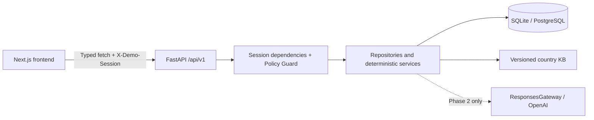

# AI Insurance Companion

## Overview

Insurra helps Indonesian speakers understand unfamiliar health insurance systems. The intended product connects document evidence, policy questions, coverage checks, care pathways, and claim preparation in one workspace.

This repository implements **Phase 1.5: Shared Foundation Alignment** of a 48-hour hackathon MVP. Its working demo uses entirely synthetic data for Raka, a student in Melbourne, and Sinta, a new employee in Jakarta. No real policy documents, personal identifiers, provider integrations, or paid credentials are required.

## Hackathon Scope

Phase 1.5 aligns the existing foundation with the complete PRD while preserving the working demo. It adds contracts, minimal shared storage, security boundaries, KB structures and tests. Product workflows and screen implementations remain deferred. Future routes return `501 NOT_IMPLEMENTED` after identity, purpose and object-scope checks. No team ownership, feature branches or deployments are assigned or created.

## Features

Implemented:

- Backend-backed, isolated demo sessions with opaque tokens, hashed at rest, expiring after 24 hours.
- Independent `process_documents`, `external_ai`, and `retention` grants, false by default, with policy versions and grant/revocation timestamps. The existing demo control manages document-processing consent only; the canonical API manages all three purposes.
- Session-scoped profile read/update, optional PRD profile metadata, seeded insurance records, and filtered audit history with optional pagination. Actor contracts distinguish demo sessions from future authenticated accounts.
- Versioned, validated AU/ID country configuration and idempotent fixture seeding.
- Deterministic, inclusive interval calculation: Raka has a **potential 76-day gap**, 16 April–30 June 2027. Because rules/policies are unverified, status is `NEEDS_VERIFICATION`, not a legal finding. Sinta returns `NOT_APPLICABLE`.
- Responsive Indonesian application shell, persona selection, onboarding, dashboard, document metadata and audit pages.
- Public cover, Google OAuth sign-in, revocable seven-day account sessions, and a guest/demo path.
- Generated TypeScript/OpenAPI contracts, contract-drift checks, typed GET/POST/PUT/PATCH/DELETE and multipart/no-content/stream transport, additive migrations, scope/approval primitives, and automated verification.

Contract-only (`501`): password registration/login/recovery, document upload/detail/delete and field review, completeness, home summary, policy Q&A/SSE, pathway comparison, triage, claim cases/evidence/draft, action decisions/execution, data inventory/deletion, coverage needs, audit detail and sandbox submission. These are shared interfaces, not implemented product features. P1/bonus features and the full nineteen-screen PRD remain deferred; current pages are preserved.

## Tech Stack

- Frontend: Next.js 16 App Router, React 19, TypeScript 5 strict mode, Tailwind CSS 4, initialized shadcn/ui Radix Button, Lucide, native fetch, React Context.
- Backend: Python 3.11+, uv, FastAPI, Pydantic v2/Settings, SQLAlchemy 2, Alembic, Uvicorn, pytest, httpx, Ruff.
- Persistence: SQLite locally; PostgreSQL through psycopg and `DATABASE_URL`. Supabase PostgreSQL is a future deployment option; Storage is not integrated.
- AI seam: OpenAI Python SDK, Responses API and Pydantic Structured Outputs. Models default to `gpt-6.1-sol` and `gpt-6-luna`, both configurable. No Phase 1.5 route calls AI; account/model availability is not tested.
- Contracts: OpenAPI → openapi-typescript. Browser smoke tests: Playwright/Chromium.
- Deployment targets only: Vercel frontend and Railway backend. No deployment configuration or deployment is performed.

Verified core versions: Next.js 16.4.2, React 19.3.1, TypeScript 5.9.3, Tailwind 4.3.3, Python 3.11.15, FastAPI 0.143.3, Pydantic 2.14.1, SQLAlchemy 2.1.5, Alembic 1.20.0, OpenAI SDK 2.54.0 and uv 0.13.1.

Exact dependency versions are pinned by `backend/uv.lock` and `frontend/package-lock.json`.

## Architecture



The backend owns domain contracts, calculations, consent and ownership. The frontend owns presentation and explicitly displays uncertainty. Requests use a shared `ApiError` envelope, request IDs, and `Cache-Control: no-store`.

## Project Structure

```text
.
├── frontend/
│   ├── src/app/             # Landing, onboarding, dashboard, documents,
│   │                       # ask-policy, coverage, care, claims, audit
│   ├── src/components/      # Application shell and reusable UI
│   ├── src/lib/api/         # Typed client + generated types.gen.ts
│   ├── src/lib/session.tsx  # Per-tab demo session lifecycle
│   └── tests/               # HTTP transport unit + desktop/mobile demo tests
├── backend/
│   ├── app/api/v1/          # Functional endpoints and 501 skeletons
│   ├── app/schemas/         # Pydantic domain/API/KB contracts
│   ├── app/models/          # SQLAlchemy persistence
│   ├── app/repositories/    # Session-scoped data access
│   ├── app/services/        # Rules, KB, guards, audit, AI extension seam
│   ├── app/seeds/           # Idempotent synthetic templates
│   ├── app/tests/           # API, rules, guard, migration/seed tests
│   ├── migrations/          # Explicit Alembic revision history
│   └── openapi.json         # Generated API snapshot
├── kb/{AU,ID}/              # Versioned configuration, never legal advice
├── fixtures/{raka,sinta}/   # Synthetic profiles, records, metadata, placeholders
├── scripts/                # Offline OpenAPI export and drift verification
├── docs/prd/               # Tracked traceability/routes/API/schema/decisions docs
│                           # Original local CSVs stay ignored and byte-identical
├── AGENTS.md
├── .env.example
└── Makefile
```

## Prerequisites

Python 3.11+, Node.js 20.9+ (verified with Node 24.21.0), npm, and `make`. An installed `uv` is preferred; `make setup` bootstraps a repository-local uv into ignored `.tools/` when absent. Initial package/browser downloads require internet access. Guest/demo mode needs no OAuth credential; Google sign-in requires a Google OAuth client and PostgreSQL database.

## Quick Start

From a checkout of this repository:

```sh
cd /path/to/insurra
cp .env.example .env
make setup
make migrate
make seed
```

In one terminal:

```sh
make dev-backend
```

In another:

```sh
make dev-frontend
```

Open **http://localhost:3000**. Choose Raka or Sinta, grant consent (or explicitly view seeded data without it), and visit the dashboard. Consent can be revoked under Privacy & Consent; audit history records changes. Selecting a different persona creates a fresh session and clears the previous frontend state.

Backend: **http://localhost:8000**. Interactive API docs: **http://localhost:8000/docs**. Verify:

```sh
make test
make check
make generate-types
make check-contracts
make test-client
```

Next uses Webpack for dev/build to avoid Turbopack worker-port restrictions in some local sandboxes. Fonts use a local system stack; builds need no Google Fonts network access.

## Environment Variables

Copy the root `.env.example` to `.env`. Pydantic and Next's configuration read this file; exported environment variables take precedence. Only the public API base URL is referenced in browser code.

| Variable | Local default / purpose |
| --- | --- |
| `DATABASE_URL` | `sqlite:///./dev.db`; resolves in `backend/` with Make commands |
| `FRONTEND_ORIGIN` | `http://localhost:3000`; one explicit CORS origin, wildcard rejected |
| `NEXT_PUBLIC_API_BASE_URL` | `http://localhost:8000`; browser-visible backend URL |
| `OPENAI_API_KEY` | Empty; optional server-only Phase 2 credential |
| `OPENAI_MODEL` | `gpt-6.1-sol`; configurable primary model |
| `OPENAI_FAST_MODEL` | `gpt-6-luna`; configurable lightweight model |
| `ENVIRONMENT` | `development` |
| `SESSION_TTL_HOURS` | Optional, defaults to `24` |
| `KB_ROOT` | Optional absolute override for the `kb/` folder |
| `GOOGLE_CLIENT_ID`, `GOOGLE_CLIENT_SECRET` | Server-only Google OAuth credentials |
| `GOOGLE_REDIRECT_URI` | Backend callback; locally `http://localhost:8000/auth/google/callback` |
| `FRONTEND_URL`, `BACKEND_URL` | Trusted application URLs used by OAuth redirects |
| `SESSION_SECRET` | Random server-only secret reserved for session hardening |
| `ACCOUNT_SESSION_TTL_DAYS` | Account session lifetime; defaults to `7` |

Never prefix secrets with `NEXT_PUBLIC_`. In future hosted builds, supply the public base URL at frontend build time and backend credentials through server environment configuration.

## Demo Personas

**All data and providers are synthetic.** Template UUIDs are replaced for every session, including policy and document references.

| Persona | Context | Seed record | Visa interval |
| --- | --- | --- | --- |
| Raka | Student, Melbourne, AU, abroad | OSHC category; coverage ends 2027-04-15; stay ends 2027-06-30 | Potential 76-day gap; needs verification |
| Sinta | Employee, Jakarta, ID, domestic | BPJS and employer insurance categories | Not applicable |

Benefit coverage stays `UNKNOWN`, amounts stay null, and policies remain `UNVERIFIED`. Text files explicitly identify themselves as synthetic placeholders, never actual policy clauses. Placeholder evidence has no invented page number and is not used as benefit evidence. Document hashes describe those actual fixture bytes. Seeding persists validated persona templates, not consented sessions; document metadata is included in the seeded unified record.

## API Documentation

OpenAPI UI: `/docs`; machine schema: `/openapi.json`; health: `/health`. Domain endpoints use `/api/v1` and `X-Demo-Session`. Session creation returns the token once; subsequent responses do not return it.

| Method | Path | Behavior |
| --- | --- | --- |
| GET | `/health` | Health and application version |
| GET | `/api/v1/countries` | Validated manifests discovered from KB folders |
| GET | `/api/v1/demo/personas` | Available seeded synthetic personas |
| POST | `/api/v1/demo/sessions` | `{ "persona_id": "raka" }` or `"sinta"`; 201 and opaque token |
| GET | `/api/v1/demo/sessions/me` | Current session, excluding token |
| GET / PUT | `/api/v1/consent` | Deprecated compatibility view/update of process_documents only |
| GET / POST | `/api/v1/consents` | Read all grants / explicitly update `{ "purpose": "external_ai", "granted": true, "policy_version": "1.5" }` |
| GET / PUT | `/api/v1/profile` | GET returns bare profile; PUT merges provided fields and returns `{profile,suggested_docs}`; IDs/timestamps cannot be overwritten |
| GET | `/api/v1/insurance/record` | Session-owned seeded insurance record |
| GET | `/api/v1/assessments/visa-gap` | Deterministic calculation; audit event |
| GET | `/api/v1/audit?event_type=CONSENT_GRANTED` | Scoped array; also supports type=consent, optional limit/offset and X-Total-Count |

Canonical P0 future contracts return **501**; the complete method/path/schema/consent matrix is in [API_CONTRACTS.md](docs/prd/API_CONTRACTS.md). The PRD `/api/...` paths map to `/api/v1/...`. Existing `/chat/ask`, `/care/compare`, `/claims/draft`, `/documents/upload`, `/assessments/completeness` and `/assessments/coverage-needs` foundation stubs remain compatible aliases with their original response shapes; canonical PRD routes use `/ask`, `/pathways/compare`, `/claims`, `/documents`, `/completeness` and `/coverage-needs`.

Identity failures return 401, missing required purposes return 403, and foreign/missing object IDs return the same 404. Owned deferred operations return 501. Body references (coverage/claim/document/action IDs) are scoped as well. Invalid input returns 422 without echoing raw values. Every error uses `ApiError(code,message,details,request_id)`. Privacy deletion requires identity and exact `confirm: "HAPUS"`, never processing permission, and always returns 501 until complete cleanup exists.

Canonical PUT `/profile` now returns `{profile,suggested_docs}`; PUT consumers must read `.profile`. Existing GET/demo behavior remains unchanged. Full legacy update bodies and partial PRD bodies are accepted; same-country omitted fields are preserved, country switches reset omitted destination metadata, and merged dates are validated before saving. Suggestions only project a VERIFIED versioned country KB resource (max six); shipped unverified resources return an empty list.

New generic claim-list contracts use `items` (each containing `case`, `checklist`, `consistency_checks`) plus `pagination(limit,offset,total)` with limits 1–100. Existing audit list stays an array and remains unbounded if limit is omitted, preserving old callers; new callers should request `limit=20&offset=0`. Optional `type` values are answer, compare, action, guardrail, deletion and consent. Exact `event_type` continues to work.

The client retains static `get/post/put` convenience calls. Use `api.request(method, pathTemplate, { token, params, query, body, signal })` for generated dynamic routes, `api.patch/delete` for those methods, and `api.stream` for future native byte-stream transport. Browser FormData sets its own boundary. No stream parser or AI response engine is active; all corresponding server routes still return ApiError/501.

## Database & Migrations

`make migrate` applies `0001` → `0002` → `0003` without resetting data. `0001` is unchanged. `0002` adds purpose grants plus owner-scoped document, extracted-field, claim-case and action primitives; it backfills the historical boolean into process_documents only. It retains legacy rows, timestamps and audit history. **external_ai and retention are never inferred from that boolean.** `0003` adds canonical server action payload storage for approval-hash binding; it does not approve/execute actions or promote statuses.

`0002` must run against an online database because it reads historical rows for its portable UUID/timestamp-preserving backfill; `alembic --sql` is deliberately rejected for that revision. SQLite fresh and populated upgrade tests pass. New table DDL compiles for PostgreSQL, but no live PostgreSQL/Supabase upgrade was run. Use `make migrate` for both local and configured PostgreSQL environments.

Original tables remain: demo_sessions, profiles, consents, insurance_records, audit_events, persona_templates. Added shared tables: purpose_consents, documents, extracted_fields, claim_cases, actions. Every new table has a specific identifier/consent/provenance purpose; these are not functioning product workflows. Composite owner foreign keys prevent cross-session document→field and claim→action links. Coverages remain validated insurance-record JSON and are scoped at API boundaries. Deeper feature storage, pages/OCR, benefits/chunks, claim histories, P1 and bonus tables are deferred. See [SCHEMA_MAPPING.md](docs/prd/SCHEMA_MAPPING.md).

Startup never creates tables automatically. `make seed` inserts missing validated templates and leaves existing sessions untouched; repeat runs insert zero templates. Profiles use validated JSON with optional timezone/employment/dependents/coverage/priorities/budget/currency metadata, so existing rows require no destructive rewrite.

UUID/JSON types are portable; SQLite foreign keys are enabled. `postgres://` and `postgresql://` normalize to psycopg online; `postgresql+psycopg://` is accepted directly. Future Supabase deployment must use server-only connection/SSL configuration. No Storage integration is active.

## Country context and frontend route integration

Country edits select the new KB without rewriting original insurance/documents. On a country change, omitted city, timezone, institution, visa dates and budget/currency are cleared from the profile; explicit destination values remain accepted. Other same-country partial updates retain omitted values. A record/profile country mismatch returns NEEDS_VERIFICATION with no numerical gap; switching back cannot reuse old visa dates unless explicitly supplied again. Demo policy/document labels show the original record country. API shapes, purpose guards and migrations are unchanged.

[SCREEN_ROUTES.md](docs/prd/SCREEN_ROUTES.md) maps every existing demo URL to its intended PRD screen: dashboard→home, ask-policy→ask, care→pathways, coverage→coverage-needs; documents/audit keep their paths. The consent-only onboarding page is not the planned profile wizard, and the claims placeholder has no detail case ID. No links, redirects or screens are added. [COUNTRY_INTEGRATION.md](docs/prd/COUNTRY_INTEGRATION.md) records US-02-02 behavior, future profile/cache coordination and exact unverified/missing KB prerequisites for SC-04, SC-07, SC-08 and SC-14.

## Country Knowledge Base

AU and ID resources now use schema version `1.5` and country version `0.2.0`. Each resource file has `schema_version`, `version`, `source_url`, `checked_at`, `verification_status`, and typed `data`. Resource versions must match the manifest. The manifest retains its sources list. The loader exposes the existing `.rules`, `.coverage_needs`, `.pathways` and `.glossary` views, plus validated `.resources`. Direct JSON consumers must now unwrap `data` instead of treating files as bare arrays/objects.

Resources: rules, coverage_needs, pathways, glossary, coverage_types, document_types, extraction_templates, suggested_docs, tasks, required_fields, recommendation_rules, verification_steps, red_flags and emergency. The root injection_patterns resource is also versioned. Structural references/duplicates and verified-source metadata are validated. Add countries through folders, without country-specific service branches.

Unknown resources are empty UNVERIFIED placeholders with null official sources/review dates. Existing vocabulary and synthetic interval configuration are retained; no legal requirements, medical trigger lists, emergency numbers, prices or policy facts are invented. There is no triage, injection detector, recommender or extraction pipeline activated by these files. Source verification and meaningful content remain future work.

The deterministic engine still unions matching policy intervals and counts inclusive uncovered calendar days once. Raka remains 76 potential gap days, never an automatic visa-violation finding. Missing dates/context return NEEDS_VERIFICATION with null counts; invalid ranges fail validation. Money remains a decimal string; no float money arithmetic or currency conversion occurs.

## Consent & Security

Google OAuth account authentication and guest/demo sessions are separate. Google uses authorization code + PKCE and provider state cookies; the backend stores accounts, provider identities, and only SHA-256 hashes of revocable seven-day session tokens. Browser account tokens stay in per-tab `sessionStorage` and are returned from the callback in a URL fragment so they are not sent in HTTP referrers or server logs. Password auth remains 501. Demo sessions continue to use hashed opaque `X-Demo-Session` tokens and synthetic data only.

Consent defaults false for all three purposes. Canonical GET/POST `/consents` reads/changes explicit purposes; policy_version is `1.5` for new decisions. The retained `/consent` API mirrors process_documents only. The existing screen grants/revokes documents only; it never silently enables AI or retention. Google sign-in does not grant processing consent.

Every protected call rechecks current database grants. Upload/external extraction/Q&A/claim-evidence stubs require process_documents AND external_ai; local processing stubs require process_documents. Seeded profile/record reads, audit and deterministic date checks remain available without those grants. Optional retention is not a processing prerequisite. Revocation blocks subsequent protected processing, but does not imply successful storage cleanup. No uploaded originals are stored by the current application; real retention cleanup must be implemented before storage is enabled.

Consent does not authorize an action. Execution/sandbox stubs require an owned persisted APPROVED action, timestamp and exact canonical server payload SHA-256, with matching request context, before returning 501. They execute nothing. Future effects must also implement idempotency and lifecycle checks; approval/execute endpoints currently never return success.

Audit metadata uses an allow-list of operational values; raw tokens, questions, document content and identifiers are excluded. Request IDs are generated by the server. CORS uses explicit frontend origins. Password authentication, medical triage, injection detection and full page/citation verification are not complete; guard extension points fail closed.

## Development Commands

| Command | Purpose |
| --- | --- |
| `make setup` | Install locked Python/npm dependencies; bootstrap uv if needed |
| `make migrate` | Apply Alembic migrations |
| `make seed` | Idempotently seed synthetic templates |
| `make dev-backend` | FastAPI reload server at localhost:8000 |
| `make dev-frontend` | Next.js development server at localhost:3000 |
| `make test` | Backend tests, isolated migrated SQLite DBs |
| `make check` | Ruff check/format, ESLint, strict TypeScript, production build |
| `make generate-types` | Export Python OpenAPI then generate TypeScript types |
| `make check-contracts` | Verify committed generated artifacts and PRD HTTP route manifest without modifying them |
| `make check-prd-contracts` | Verify all 21 mapped PRD HTTP operations exist in OpenAPI |
| `make check-prd-source` | Compare local-only `docs/prd/PRD - Kontrak API.csv` against tracked manifest and OpenAPI |
| `make test-client` | Run browser-independent typed HTTP transport tests |

The source PRD CSV files are intentionally ignored. `make check-prd-contracts` checks the
committed normalized HTTP manifest without private CSV access. When the local PRD CSV
is available, use `make check-prd-source` to detect source-to-manifest drift. This
checks HTTP methods, routes, multipart/query transport and registered response
status codes; it does **not** prove semantic equivalence of every nested request/
response field or completion of 501 feature routes. Review payload differences in
`docs/prd/API_CONTRACTS.md` and `docs/prd/DECISIONS.md` before changing wire shapes.
The CI workflow runs checks and browser smoke tests on locked dependencies; it has been validated locally with actionlint, but no hosted CI execution is claimed.

## Testing

Country-context integration verification on 17 October 2026: **134 backend tests, 7 typed-client tests and 4 desktop/mobile browser cases passed.** Ruff, ESLint, strict TypeScript, production build, migration/seed commands and generated-contract drift checks passed. No dependency upgrades were needed.

Baseline stabilization commands and limitations are recorded in [FOUNDATION_VERIFICATION.md](docs/FOUNDATION_VERIFICATION.md). Current focused integration checks and decisions are in [COUNTRY_INTEGRATION.md](docs/prd/COUNTRY_INTEGRATION.md).

Verification includes backend API/rules tests, fresh/populated migrations without data loss, idempotent fixtures, independent consent grant/revocation, owner-IDOR guards, composite foreign keys, persisted approval/hash validation, audit redaction/query pagination, OpenAPI references/snapshot and TypeScript artifact drift. No OpenAI key or live call is required.

`make test-client` runs typed transport tests for query encoding, multipart boundaries, PATCH/DELETE path/body handling, 204, future streaming/error responses, cancellation and compile-time contract misuse. `make check` covers Ruff, ESLint, strict TypeScript and the production build. PostgreSQL DDL is compiled in tests; a live database migration remains untested.

For browser tests, with ports 3000/8000 available:

```sh
cd frontend
npx playwright install chromium
npm run test:e2e
```

Playwright starts both local services, migrates/seeds a separate `.cache/e2e.db`, and runs the complete flow at desktop and mobile widths. With `CI=1`, it builds and serves the production frontend so assertions do not depend on development-route compilation; local runs use the development server. It checks consent, Raka's backend result, reload persistence, documents, audit filtering, revocation, persona switching, Sinta isolation, runtime errors and horizontal overflow. When services already run, Playwright reuses them; use `CI=1` to require fresh servers and the production frontend. A custom `PLAYWRIGHT_BROWSERS_PATH` may be used in restricted environments.

## Known Limitations

- All future product/auth/privacy/streaming routes are deliberate 501s; no actual uploads/storage, parsing/OCR, retrieval, chat, care advice, benefit assessment, claim draft or execution is enabled.
- Source validation and approval checks are conservative foundations, not completed citation/injection/triage/execution safeguards. File size/MIME enforcement, cleanup, upload deduplication/cache and rate limiting remain feature implementation work.
- KB configuration is unchecked demo material, not regulatory guidance. No emergency-number or legal-compliance claims are made.
- No live PostgreSQL, Supabase, OpenAI model availability, deployment or real provider integration was tested.
- The installed Starlette/FastAPI test client emits a deprecation notice for httpx; tests still pass with the requested httpx dependency.
- `npm audit` reports five high findings in the development lint chain (`braces` → `micromatch` → `fast-glob` → Next ESLint tooling). No patched compatible `braces` version was available when installed. `npm audit --omit=dev` reports zero findings. Recheck upstream before publishing; do not blindly downgrade Next or use `audit fix --force`.

## PRD Alignment & Remaining Work

Tracked mappings cover all 55 user stories (44 P0, 11 P1), all 19 screen names/routes (including the Bonus screen), every API CSV entry and shared storage decisions:

- [TRACEABILITY.md](docs/prd/TRACEABILITY.md): exact story IDs, names, priorities, foundation status and deferred integration.
- [SCREEN_ROUTES.md](docs/prd/SCREEN_ROUTES.md): planned routes vs current partial demo/shells; no nineteen-page implementation claim.
- [API_CONTRACT_MANIFEST.json](docs/prd/API_CONTRACT_MANIFEST.json): checked-in, machine-verifiable map of the 21 PRD HTTP operations. Source CSV files remain local-only.
- [API_CONTRACTS.md](docs/prd/API_CONTRACTS.md): methods, schemas, purpose requirements, compatibility and 501 boundaries.
- [SCHEMA_MAPPING.md](docs/prd/SCHEMA_MAPPING.md): added storage justifications and deferred feature tables/fields.
- [DECISIONS.md](docs/prd/DECISIONS.md): namespace, Pydantic/Zod, demo auth, consent, enums, missing evidence, duplicates and safety tradeoffs.

Original CSVs and the local alignment prompt remain reference material; CSVs are ignored, unchanged and never committed. These Markdown mappings and this README are self-contained.

## Next Steps

Verified country content, password auth, extraction/retrieval, medical routing, claim workflows, privacy cleanup, remaining feature screens and P1/bonus work require separate reviewed scope. No task is assigned to a person or team here, and no feature branch is created.

**No team ownership has been assigned. Foundation is ready for a separate feature split only after maintainer review.** Read root, frontend and backend AGENTS.md before extending the repository.
