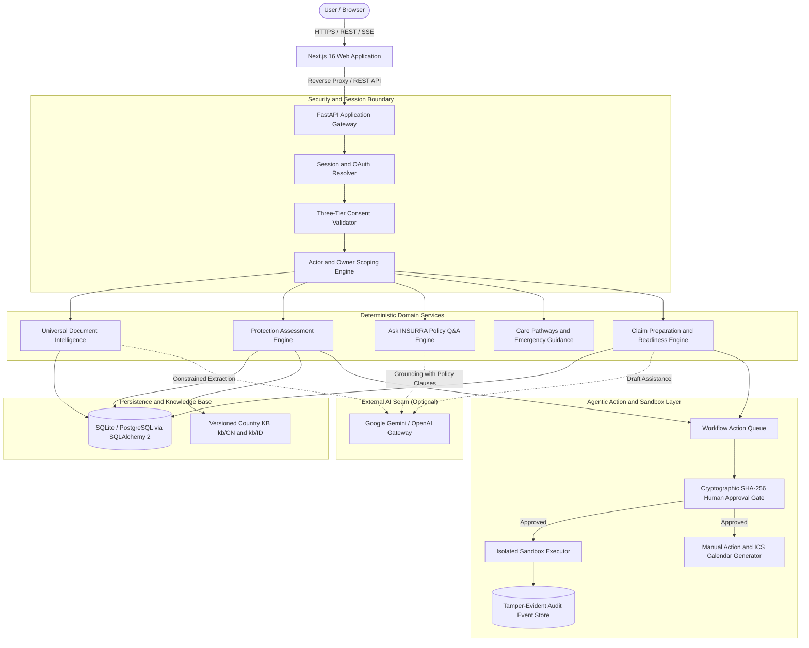
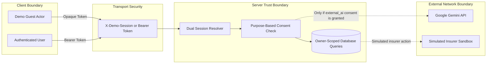
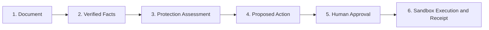

# INSURRA Architecture Guide

## 1. Overview

INSURRA is an AI Insurance Decision and Action Companion. It helps cross-border policyholders, international students, and migrant workers understand health insurance policies in China (CN) and Indonesia (ID).

The system uses a decoupled architecture:
- Frontend: Next.js 16 (App Router), React 19, TypeScript 5 (strict mode), and Tailwind CSS 4.
- Backend: FastAPI 0.143, Python 3.11+, Pydantic v2, and SQLAlchemy 2.
- Persistence: SQLite for local development and PostgreSQL for production environments.
- AI Integration: Google Gemini (default) or OpenAI models via a structured gateway seam.

INSURRA separates probabilistic generative AI from deterministic rules. Critical insurance calculations, benefit checks, and coverage gaps are always computed in deterministic Python code, never by LLM arithmetic.

## 2. High-Level System Architecture

## 3. Trust Boundaries and Security Model

INSURRA defines strict security boundaries across sessions, data access, and external AI calls.

### 3.1 Dual Session Boundary
1. Demo Sessions (`X-Demo-Session`):
   - Fast, ephemeral access for trying out pre-seeded personas (Raka and Sinta).
   - Backed by an opaque 24-hour token hashed at rest using SHA-256.
   - Demo sessions are fully isolated from registered user accounts.
2. Authenticated Accounts (Bearer Token):
   - Standard user authentication via Google OAuth 2.0 PKCE or PBKDF2 email and password.
   - Issues a secure 7-day session token.
   - Strict owner scoping ensures no cross-tenant data leakage.

### 3.2 Three-Tier Purpose Consent Model
Every protected operation checks three independent consent flags stored in the database:
- `process_documents`: Allows parsing of uploaded policy PDFs and medical receipts.
- `external_ai`: Permits sending extracted text fragments to the external AI gateway.
- `retention`: Permits long-term storage of policy records.

If `external_ai` consent is revoked, AI-based features fail gracefully and revert to deterministic catalog lookups.

## 4. Agentic AI and Human-in-the-Loop Workflow

INSURRA enforces a strict six-stage lifecycle for all agentic workflows:

1. Document Ingestion:
   - File validation (MIME type sniffer, size limits up to 10MB).
   - Multi-tier text extraction (PyPDF, pdftotext, or Tesseract OCR).
2. Fact Extraction:
   - Pydantic schema validation extracts structured policy metadata (dates, deductibles, limits, exclusions).
3. Protection Assessment:
   - Deterministic calendar interval calculation identifies coverage gaps.
   - Rule checks identify unverified terms or missing requirements.
4. Action Proposal:
   - High-priority actions (such as filing a claim or addressing a coverage gap) are generated with status `AWAITING_APPROVAL`.
5. Human-in-the-Loop Approval:
   - The user inspects the exact payload.
   - The approval request is bound to a SHA-256 hash of the payload (`expected_payload_hash`).
   - If the payload is modified after proposal, the approval is rejected to prevent tampering.
6. Sandbox Execution & Receipt:
   - Approved actions run in a simulated insurer sandbox.
   - Every state transition produces a cryptographically signed HMAC SHA-256 audit receipt.

## 5. Knowledge Base Architecture

The country knowledge base is organized under `kb/{ISO_CODE}`:
- `kb/CN/`: Mainland China healthcare rules, public medical insurance, and emergency contacts (120, 110, 119).
- `kb/ID/`: Indonesia healthcare guidelines, BPJS Kesehatan rules, and emergency contacts (112, 119).
- `kb/AU/`: Australian guidelines stored on disk as draft, currently inactive in production.

All KB entities include:
- `schema_version`: Currently `1.5`.
- `verification_status`: Either `VERIFIED` or `UNVERIFIED`.
- Unknown or unverified rules are never fabricated. Missing safety data causes the system to return `TRIAGE_UNAVAILABLE`.
