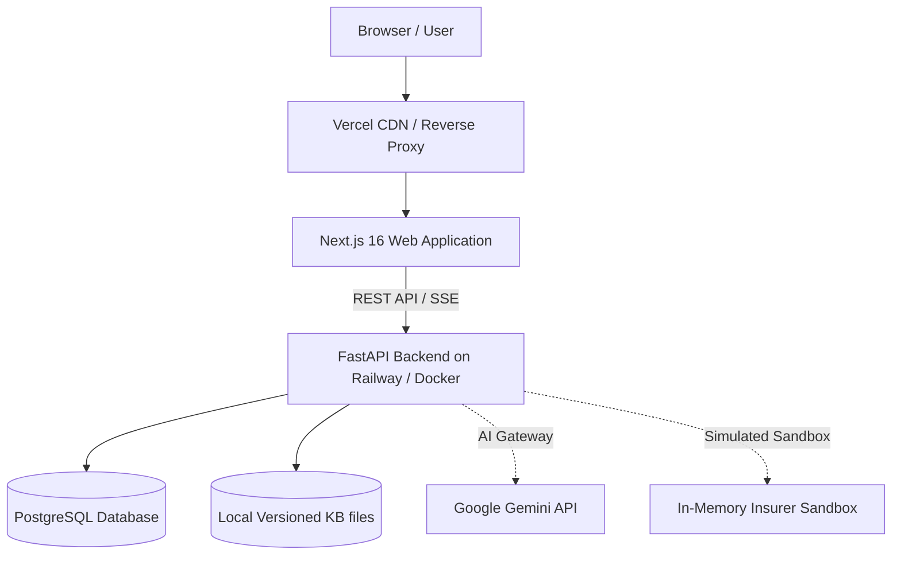

# INSURRA Deployment Guide

This guide describes how to deploy INSURRA in local, staging, and production environments.

## 1. Deployment Architecture

INSURRA consists of two decoupled services:
1. Frontend Web Service:
   - Next.js 16 (App Router) on Node.js 20+ (recommended: Node 20.9+ or Node 22).
   - Can be deployed to Vercel, Node.js Docker containers, or any standard container platform.
2. Backend API Service:
   - FastAPI application on Python 3.11+ managed by Uvicorn.
   - Can be deployed to Railway, Render, AWS ECS, or Docker containers.
3. Database:
   - Development: Local SQLite database (`dev.db`).
   - Production: PostgreSQL 15+ (e.g. Supabase PostgreSQL, AWS RDS, or Railway PostgreSQL).
4. AI Seam:
   - Google Gemini API or OpenAI API accessed securely via server-side credentials.



## 2. System Prerequisites

The hosting environment requires:
- Python 3.11 or higher (verified up to Python 3.15).
- Node.js 20.9.0 or higher (verified with Node 24.x).
- Package tools: `uv` (recommended) or standard `pip`, and `npm`.
- Tesseract OCR (optional, needed only for image-based OCR extraction):
  - macOS: `brew install tesseract tesseract-lang`
  - Debian/Ubuntu: `apt-get install -y tesseract-ocr tesseract-ocr-chi-sim tesseract-ocr-ind poppler-utils`

## 3. Environment Variables Reference

Configure these variables in your deployment environment:

| Variable | Required | Safe Default | Consumed By | Description |
|---|---|---|---|---|
| `DATABASE_URL` | Yes | `sqlite:///./dev.db` | Backend | Database connection string. Use `postgresql+psycopg://...` in production. |
| `FRONTEND_ORIGIN` | Yes | `http://localhost:3000` | Backend | Allowed CORS origin. Must match public frontend URL. |
| `NEXT_PUBLIC_API_BASE_URL` | Yes | `http://localhost:8000` | Frontend | Public backend URL called by browser client. |
| `FRONTEND_URL` | Yes | `http://127.0.0.1:3000` | Backend | Used for OAuth redirect targets. |
| `BACKEND_URL` | Yes | `http://localhost:8000` | Backend | Public backend base URL. |
| `ENVIRONMENT` | Yes | `production` | Backend | Deployment environment name (`development` or `production`). |
| `SESSION_SECRET` | Yes | *Random 32-char string* | Backend | Secret key for hashing tokens and HMAC receipts. |
| `AI_PROVIDER` | No | `gemini` | Backend | AI provider selection: `gemini` or `openai`. |
| `GEMINI_API_KEY` | Conditional | *Empty* | Backend | Required if `AI_PROVIDER=gemini` for live Q&A. |
| `GEMINI_MODEL` | No | `gemini-3.5-flash-lite` | Backend | Primary Gemini model. |
| `ACTIVE_KB_COUNTRIES` | No | `CN,ID` | Backend | Enabled countries for policy rules and safety checks. |
| `GOOGLE_CLIENT_ID` | Conditional | *Empty* | Backend | Required for Google OAuth authentication. |
| `GOOGLE_CLIENT_SECRET` | Conditional | *Empty* | Backend | Required for Google OAuth authentication. |
| `GOOGLE_REDIRECT_URI` | Conditional | *Empty* | Backend | OAuth callback URL: `<BACKEND_URL>/auth/google/callback`. |

Never expose secrets or server credentials in frontend code or repository commits.

## 4. Backend Deployment (FastAPI)

### Step 1: Install Dependencies
```bash
cd backend
uv sync --locked
```
If using standard pip:
```bash
pip install -r requirements.txt
```

### Step 2: Run Database Migrations
Always run Alembic migrations before starting the service:
```bash
cd backend
uv run alembic upgrade head
```

### Step 3: Seed Synthetic Demo Data
Seed the verified personas (Raka and Sinta) and catalog templates:
```bash
cd backend
uv run python -m app.seeds.demo
```

### Step 4: Start the Server
Start the production server using Uvicorn:
```bash
cd backend
uv run uvicorn app.main:app --host 0.0.0.0 --port 8000 --workers 4
```

## 5. Frontend Deployment (Next.js)

### Step 1: Install Dependencies
```bash
cd frontend
npm ci
```

### Step 2: Build the Application
```bash
cd frontend
npm run build
```

### Step 3: Start the Production Server
```bash
cd frontend
npm run start -- --port 3000
```

When deploying to Vercel:
- Set Root Directory to `frontend`.
- Build Command: `npm run build`.
- Output Directory: Next.js default.
- Set `NEXT_PUBLIC_API_BASE_URL` to your production backend URL.

## 6. Health Checks and Verification

### Backend Health Check
Verify backend availability and configuration:
```bash
curl -f http://localhost:8000/api/v1/health
```
Expected response:
```json
{"status":"ok","version":"1.5.0"}
```

### Database Verification
Ensure migrations are at `head`:
```bash
cd backend
uv run alembic current
```

### Contract Verification
Confirm API schemas match frontend types:
```bash
make check-contracts
```

## 7. Production vs Sandbox Differences

INSURRA operates in two distinct execution modes:
- Sandbox Mode (Default in current release):
  - Insurer submissions and action execution run in a sandboxed simulator.
  - External hospital and insurer APIs are simulated to prevent accidental real-world actions.
  - State changes generate authentic HMAC SHA-256 receipts and audit log entries.
- Production Mode (Planned for future insurer partnerships):
  - Requires certified insurer API keys and direct health provider interfaces.
  - Features without an active integration fail closed and return `501 NOT_IMPLEMENTED`.

## 8. Rollback and Troubleshooting

### Common Deployment Issues

1. CORS Errors:
   - Cause: `FRONTEND_ORIGIN` does not match the frontend URL.
   - Solution: Set `FRONTEND_ORIGIN` to the exact public protocol and domain of the frontend (e.g. `https://insurra.example.com`).

2. Missing Database Tables:
   - Cause: The server started without running database migrations.
   - Solution: Run `uv run alembic upgrade head` inside the `backend` folder.

3. Google OAuth Callback Failure:
   - Cause: `GOOGLE_REDIRECT_URI` does not match the URI authorized in Google Cloud Console.
   - Solution: Ensure `<BACKEND_URL>/auth/google/callback` is registered exactly in Google Developer Credentials.

4. Rolling Back Database Migrations:
   - To roll back the latest revision:
   ```bash
   cd backend
   uv run alembic downgrade -1
   ```
