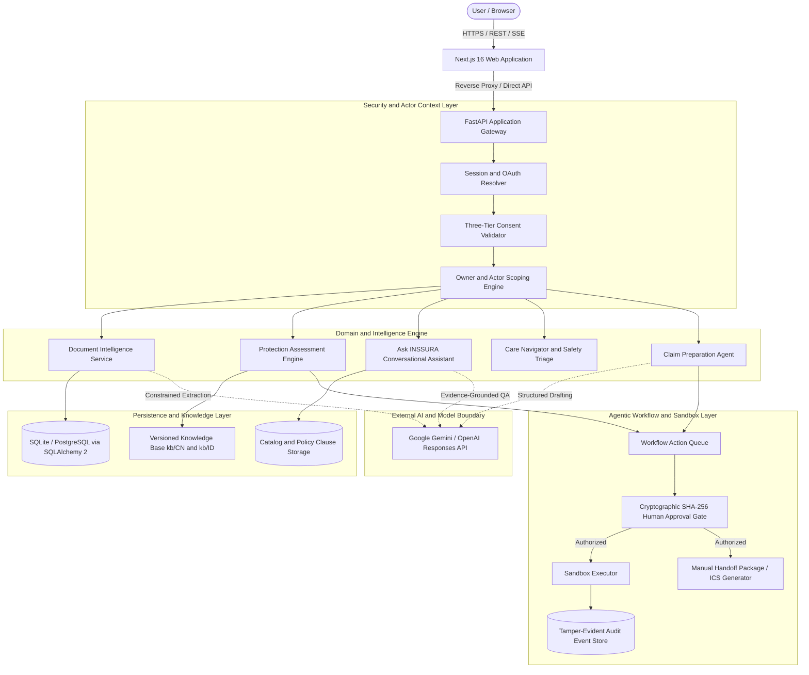
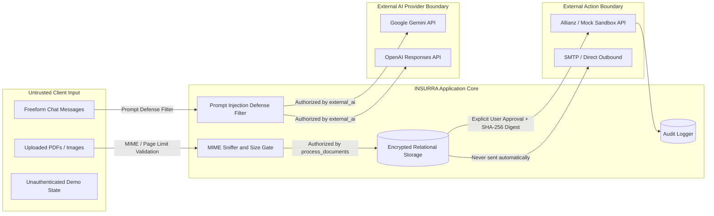
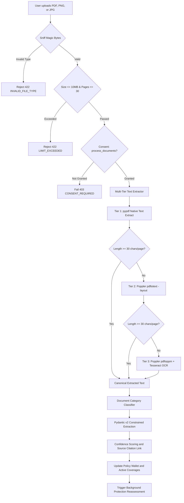
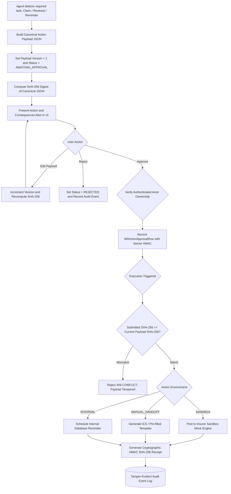
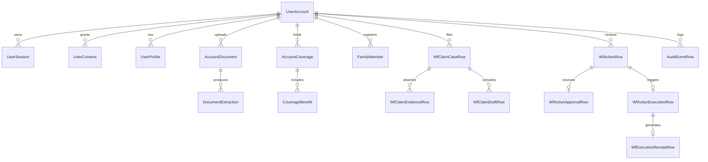

# INSURRA: System Technical Documentation

**Shenzhen FinTechathon 2026 - International Track**  
**Document Code:** 01_INSURRA_Technical_Documentation  
**Version:** 1.5.0 (Production Architecture)  
**Status:** Implemented and Verified  

### Team Information
- **Team Name:** WGTC  
- **Institution:** Universitas Indonesia  
- **Team Members:**
  - Jasmine Rakhaila
  - Anggun Sasmitha
  - Regina Aruan
  - Valentino Kim
  - Joshua Hans Vito

---

## 1. Executive Technical Summary

INSURRA is an AI-powered Insurance Decision and Action Companion designed to bridge the structural gap between complex cross-border healthcare insurance policies and everyday policyholders. The platform specifically targets Indonesian expatriates, students, and domestic workers navigating unfamiliar medical systems in mainland China (CN) and Indonesia (ID).

Unlike standard chatbots or generic LLM wrappers, INSURRA operates as a deterministic, evidence-grounded agentic system. The platform strictly enforces zero hallucination in insurance rules, mathematical calculations, and legal coverage facts.

### Key Implemented System Highlights
- **Full-Stack Decoupled Architecture:** Built on Next.js 16.4.2 (React 19, TypeScript 5.9 strict mode) and FastAPI 0.143.3 (Python 3.11+, Pydantic v2 domain schemas).
- **Dual Session Boundary:** Complete isolation between zero-persistence interactive demo sessions (`X-Demo-Session`) and persistent authenticated accounts (Google OAuth 2.0 PKCE and PBKDF2 email/password).
- **Three-Tier Explicit Consent Model:** Per-purpose consent enforcement (`process_documents`, `external_ai`, `retention`) validated on every protected API call.
- **Deterministic Document Intelligence:** Multi-tiered extraction pipeline utilizing PyPDF, Poppler `pdftotext`, and Tesseract OCR (with language packs for `chi_sim`, `eng`, and `ind`) combined with constrained Pydantic schema parsing.
- **Strict Evidence Grounding:** Coverage decisions, benefit amounts, calendar intervals, and claim checklists are calculated via deterministic Python algorithms, never inferred through generative arithmetic.
- **Bounded Agentic Actions & Cryptographic Integrity:** All external modifications or insurer submissions require explicit human-in-the-loop approval bound cryptographically to a canonical SHA-256 payload digest and signed with an HMAC SHA-256 receipt.
- **Honest Sandboxing:** Simulated insurer interactions run against an isolated sandbox with explicit, non-misleading status reporting.

---

## 2. System Architecture

### 2.1 High-Level System Architecture

The following diagram illustrates the complete flow of data and control from the user interface down to persistence, agent reasoning, and sandbox execution:



---

### 2.2 Data and Trust Boundaries

Security boundaries in INSURRA isolate private policy data, untrusted uploaded files, and external AI providers:



---

### 2.3 End-to-End Document Intelligence Flow



---

### 2.4 End-to-End Bounded Agentic Action Flow



---

## 3. Product and System Overview

### 3.1 Problem Domain and Target Users
Indonesian citizens living or studying abroad face significant friction when trying to use health insurance:
1. **Terminology and Structural Gaps:** Insurance documents in mainland China (such as Ping An or China Life policies) use complex regulatory terms (e.g., social insurance deduction ratios, tiered co-pays, designated triple-A public hospital requirements). Policyholders struggle to comprehend what is covered.
2. **Disconnected Evidence:** Coverage terms, medical receipts, referral letters, and visa documents are stored in disconnected locations, resulting in missed claim filing deadlines and unexpected out-of-pocket expenses.
3. **Language Barriers:** Policies are issued in Mandarin or formal legal Indonesian, while policyholders require plain-language answers in Indonesian or English with precise source citations.
4. **Fear of Unauthorized External Execution:** Users hesitate to use AI platforms for sensitive financial and medical documents without strict privacy guarantees and explicit control over external data transmission.

### 3.2 Supported Jurisdictions and Active Knowledge Bases
The platform currently activates two primary jurisdictional knowledge bases located under `backend/app/kb/` and `kb/`:
- **China (CN):** Focuses on international students and expatriates. Features public medical tiers (Class 3A / Sanjia hospitals), commercial supplemental policies (Ping An Student Medical Insurance), outpatient emergency limits, visa continuity rules, and cross-border repatriation guidelines.
- **Indonesia (ID):** Focuses on domestic and returning citizens. Features BPJS Kesehatan coordination of benefits, private health riders (Allianz, Prudential), referral systems (Faskes 1 to Faskes Rujukan), and private hospital networks.

### 3.3 Persona and Session Scoping
INSURRA supports three strictly demarcated operational modes:
1. **Public Visitor:** Can browse landing pages, general insurance concepts, and static comparisons. No private document storage is permitted.
2. **Isolated Interactive Demo:** Designed for instant exploration without sign-up. Uses an opaque `X-Demo-Session` token kept strictly in browser `sessionStorage`. Comes pre-seeded with two realistic personas:
   - *Raka (Shenzhen, China):* International student at Shenzhen University under a student visa, holding Ping An Comprehensive Health Insurance.
   - *Sinta (Jakarta, Indonesia):* Professional employee in Jakarta holding company group insurance coordinated with BPJS Kesehatan.
3. **Authenticated Account:** Secured via Google OAuth 2.0 or verified email and password. Owns persistent documents, verified coverage policies, customized family trees, audit trails, and action queues.

---

## 4. Component Architecture

The codebase is organized cleanly into modular, domain-driven sub-packages:

```
INSURRA/
├── backend/
│   ├── app/
│   │   ├── agent/               # Agent definitions, prompts, and tool registries
│   │   │   ├── care_navigator.py    # Clinical safety triage and care routing
│   │   │   ├── langchain_agent.py   # Ask INSSURA conversational assistant
│   │   │   ├── protection_review.py # Protection gap assessment agent
│   │   │   ├── tools.py             # 33 deterministic, actor-scoped tools
│   │   │   └── worker.py            # Background agent task scheduler
│   │   ├── api/                 # REST endpoints grouped by version and domain
│   │   │   ├── v1/                  # Canonical Phase 1.5 endpoints
│   │   │   │   ├── actions.py           # Action proposals, approvals, executions
│   │   │   │   ├── audit.py             # Tamper-evident audit log access
│   │   │   │   ├── claims.py            # Claim cases, readiness, drafting
│   │   │   │   ├── coverage_needs.py    # Multi-dimensional coverage needs API
│   │   │   │   ├── documents.py         # Document upload, extraction, verification
│   │   │   │   └── profile.py           # User profile and suggested documents
│   │   │   └── auth.py              # Google OAuth 2.0 and session endpoints
│   │   ├── core/                # System settings, security, and exception filters
│   │   │   ├── config.py            # Pydantic BaseSettings environment loader
│   │   │   ├── errors.py            # Standard ApiError schema and exception handlers
│   │   │   └── security.py          # Session hashing, token verification, PBKDF2
│   │   ├── models/              # SQLAlchemy 2.0 ORM entity definitions
│   │   │   ├── account_data.py      # User profiles, documents, coverages, family
│   │   │   ├── auth.py              # User credentials and session tokens
│   │   │   ├── catalog.py           # Standardized insurance taxonomy and products
│   │   │   └── workspace_state.py   # Action queues, approvals, receipts, claim cases
│   │   ├── services/            # Pure business logic and algorithmic engines
│   │   │   ├── account_documents.py # File sniffing, extraction, Poppler/OCR
│   │   │   ├── ai_gateway.py        # Resilient client for Gemini and OpenAI
│   │   │   ├── anti_lapse_agent.py  # Policy renewal and continuity tracking
│   │   │   ├── claim_preparation_agent.py # Deterministic claim form synthesis
│   │   │   ├── employer_benefits_service.py # Coordination of benefits engine
│   │   │   ├── family_protection_engine.py  # Household dependency analyzer
│   │   │   └── protection_assessment.py     # Deterministic benefit gap engine
│   │   └── workflow/            # Workflow orchestration, sandbox, and receipts
│   │       ├── actions.py           # Action state machine and HMAC receipts
│   │       ├── claims.py            # Claim readiness and evidence mapping
│   │       ├── executors.py         # Sandbox submission and ICS generator
│   │       └── sandbox.py           # Mock insurer validation engine
│   └── migrations/              # 19 additive Alembic migrations
└── frontend/
    ├── src/
    │   ├── app/                 # Next.js App Router pages
    │   │   ├── account/             # Onboarding, completeness, privacy settings
    │   │   ├── actions/             # Action approval queue and execution logs
    │   │   ├── ask/                 # Ask INSSURA policy question and answer UI
    │   │   ├── claims/              # Claim readiness, case detail, evidence review
    │   │   ├── coverage-needs/      # Gap analysis and recommendations
    │   │   ├── documents/           # Document repository and extraction viewer
    │   │   ├── emergency/           # Emergency guide and red-flag screening
    │   │   ├── employer-benefits/   # Corporate benefits and CoB analysis
    │   │   ├── family/              # Dependent and family coverage manager
    │   │   ├── home/                # Command Center dashboard
    │   │   └── pathways/            # Care pathways and provider navigator
    │   ├── components/          # Reusable UI widgets, modals, layouts
    │   └── lib/                 # Client utilities, auth hooks, typed API client
```

---

## 5. Core Algorithms and AI Techniques

### 5.1 Document Intelligence Engine
Located in `backend/app/services/account_documents.py`, this engine ingests raw files and transforms them into verified structured coverage data:
1. **Magic Byte Sniffing:** Inspects the first 8 bytes of file uploads to verify true MIME types (`application/pdf`, `image/jpeg`, `image/png`). File extensions are never trusted.
2. **Resource Constraints:** Enforces a maximum upload size of 10 MB (`MAX_FILE_BYTES = 10 * 1024 * 1024`) and a hard limit of 30 pages (`MAX_PDF_PAGES = 30`).
3. **Multi-Tier Text Extraction:**
   - *Tier 1 (Native Digital):* Parses text using `pypdf.PdfReader`. Fast, in-memory, zero external subprocess overhead.
   - *Tier 2 (Structured Layout):* If Tier 1 produces less than 30 characters per page, invokes Poppler `pdftotext -layout`.
   - *Tier 3 (Optical Character Recognition):* If text remains under 30 characters, renders page bitmaps via `pdftoppm -r 160 -png` and runs `tesseract` using language bundles selected by jurisdiction (`CN`: `eng+ind+chi_sim`; `ID`: `eng+ind`).
4. **Constrained Schema Extraction:** Extracted text is parsed through `GeminiGateway` or `ResponsesGateway` using strict Pydantic models (`ExtractionResult`, `CandidateField`).
5. **Human Verification Workflow:** Extracted fields remain in a `NEEDS_VERIFICATION` state until the user inspects the extracted values alongside the original page citation.

### 5.2 Deterministic Protection Assessment Engine
Located in `backend/app/services/protection_assessment.py`, this engine computes coverage adequacy without relying on unpredictable LLM arithmetic:
1. **Standardized Benefit Taxonomy:** Evaluates 12 universal insurance categories:
   - Inpatient Hospitalization (`inpatient_hospitalization`)
   - Outpatient Emergency (`outpatient_emergency`)
   - Routine Outpatient (`outpatient_routine`)
   - Critical Illness (`critical_illness`)
   - Accidental Death and Dismemberment (`accidental_death`)
   - Medical Evacuation and Repatriation (`medical_evacuation`)
   - Dental Care (`dental_care`)
   - Vision Care (`vision_care`)
   - Mental Health (`mental_health`)
   - Prescription Medications (`prescription_drugs`)
   - Maternity and Newborn (`maternity`)
   - Preventive and Wellness (`preventive_care`)
2. **Status Classification Logic:** Each category is deterministically assigned one of five strict statuses:
   - `COVERED`: Active verified policy covers the benefit with clear limits and no critical gaps.
   - `PARTIALLY_COVERED`: Benefit is covered but carries significant restrictions, high deductibles, or low sub-limits.
   - `NOT_COVERED`: Benefit is completely absent from all active policies.
   - `UNKNOWN`: Declared or extracted document lacks verifiable limit clauses.
   - `NOT_APPLICABLE`: Benefit is not relevant to the user's demographic profile (e.g., maternity for non-relevant segments).
3. **Calendar Interval Arithmetic:** Uses pure Python `datetime` and `calendar` arithmetic to detect insurance-to-visa mismatches, waiting period expirations, and premium grace periods.

### 5.3 Ask INSSURA Conversational Engine
Located in `backend/app/agent/langchain_agent.py` and `backend/app/services/policy_qa.py`:
1. **Prompt Structure (LangChain Style):** Uses structured templates featuring strict system instructions, retrieved policy clauses, and conversation memory.
2. **Context-Aware Evidence Retrieval:** Queries only documents and coverages owned by the verified caller. The prompt injects verified policy clauses as untrusted reference data.
3. **Zero-Hallucination Guardrails:** If a requested benefit or treatment is not explicitly mentioned in the retrieved clauses, the prompt strictly mandates replying that the benefit is unverified or not found.
4. **Prompt Injection Defense:** Input filters strip system prompt overriding attempts, role-switch prompts, and delimiter injection attacks.

### 5.4 Care Pathways and Clinical Safety Screening
Located in `backend/app/agent/care_navigator.py` and `backend/app/services/care_pathways.py`:
1. **Safety Triage Filter:** Runs ahead of care recommendations to screen for life-threatening symptoms (chest pain, severe bleeding, difficulty breathing, neurological deficits).
2. **Immediate Red-Flag Redirect:** When danger signs are detected, the system immediately halts insurance discussions and displays emergency numbers (e.g., 120 in China, 112 in Indonesia) and hospital directions.
3. **Jurisdiction-Aware Facility Routing:** For non-emergency care, routes users to appropriate tiers:
   - In China: Class 3A Public Hospitals (三甲医院) for standard coverage compliance, VIP/International clinics (特需门诊) when policy permits.
   - In Indonesia: Faskes Primer (Puskesmas/Klinik BPJS) or private network hospitals according to primary/rider policy rules.

### 5.5 Claim Readiness and Preparation Engine
Located in `backend/app/services/claim_preparation_agent.py` and `backend/app/workflow/claims.py`:
1. **Deterministic Readiness Check:** Compares available user documents against mandatory procedural requirements (e.g., official invoice, diagnosis certificate, itemized prescription list).
2. **Readiness Scoring:** Computes readiness as `(verified_items / required_items) * 100`, identifying blocking evidence gaps before claim submission.
3. **Structured Claim Form Synthesis:** Synthesizes draft claim payloads conforming to insurer schemas. Validates policy numbers, incident dates, amounts, and diagnosis codes via Pydantic validators.

### 5.6 Anti-Lapse and Policy Continuity Engine
Located in `backend/app/services/anti_lapse_agent.py`:
1. **Continuous Date Tracking:** Analyzes expiry dates across primary policies, supplemental riders, and residency permits.
2. **Automated Warning Thresholds:** Flags critical windows at 60, 30, and 14 days prior to coverage termination.
3. **Action Queue Generation:** Automatically drafts renewal inquiries or calendar reminder proposals without requiring user prompt initiation.

---

## 6. Security Architecture and Permission Tiers

### 6.1 Authentication and Actor Resolution
Every incoming request is resolved by `get_current_actor` in `backend/app/core/security.py`:
- **Demo Actor:** Resolved via `X-Demo-Session` header. Token must be an opaque hexadecimal string with verified session state in the database.
- **Account Actor:** Resolved via standard `Authorization: Bearer <token>` header. Token is validated against active database user sessions.
- **Strict Isolation:** Demo sessions cannot access account entities, and accounts cannot access demo data. Passing a raw account ID or spoofed identifier returns a 401 Unauthorized or 404 Not Found.

### 6.2 Three-Tier Explicit Consent Architecture
Enforced on every protected service call through `check_consent` in `backend/app/services/consents.py`:
- `process_documents`: Authorizes local file parsing, Poppler text extraction, and Tesseract OCR.
- `external_ai`: Authorizes sending anonymized text extracts to external LLM providers (Google Gemini or OpenAI).
- `retention`: Authorizes storing conversation history beyond the active transient session.

Consent is checked live in the database on every invocation. If consent is revoked, subsequent calls immediately fail closed with `403 FORBIDDEN (CONSENT_REQUIRED)`.

### 6.3 Cryptographic Action Authorization
All agent actions requiring approval follow a verifiable cryptographic contract:
1. **Canonical JSON Serialization:** The action payload is sorted by key and serialized without whitespace.
2. **Payload Digest:** A SHA-256 digest is generated from the canonical bytes:
   $$\text{Digest} = \text{SHA-256}(\text{CanonicalPayload})$$
3. **HMAC Signature:** Upon user approval, the server signs the execution record using HMAC SHA-256:
   $$\text{Signature} = \text{HMAC-SHA256}(K_{\text{session}}, \text{ReceiptRef} \parallel \text{Digest} \parallel \text{Status} \parallel \text{Timestamp})$$
4. **Tamper Detection:** If the payload is modified after approval, the hash check fails immediately with `409 CONFLICT`, invalidating prior approval.

---

## 7. Data Model and Schema Architecture

### 7.1 Database Entity Relationship Overview

The following diagram shows the core relational schema implemented across the 19 Alembic migrations:



### 7.2 Primary Entity Definitions
- **`user_accounts`:** Core identity entity storing email, password hash (PBKDF2), Google ID, verification status, and lockout counters.
- **`user_consents`:** Tracks boolean consent grants per purpose (`process_documents`, `external_ai`, `retention`) with timestamps.
- **`account_documents`:** Metadata for uploaded files, including storage path, MIME type, page count, and cryptographic hash.
- **`account_coverages`:** Active policies belonging to a user, linking provider name, policy number, country, and validity window.
- **`wf_claim_cases`:** Central claim entity tracking procedure name, total claimed amount, status (`DRAFT`, `READY`, `SUBMITTED`), and incident dates.
- **`wf_actions`:** Agent-generated action queue tracking type (`sandbox_claim_submit`, `calendar_reminder_file`, `employer_benefit_inquiry`), approval requirement, canonical payload, and SHA-256 hash.
- **`wf_execution_receipts`:** Tamper-evident execution record storing the payload digest, environment (`SANDBOX`, `MANUAL_HANDOFF`, `INTERNAL`), timestamp, and HMAC signature.
- **`audit_events`:** Append-only log recording every sensitive action, actor identity, IP address, and execution result.

---

## 8. Deployment and Reproducibility

### 8.1 Actual Local Development Startup

```bash
# 1. Clone repository
git clone https://github.com/your-org/insurra.git
cd insurra

# 2. Environment Configuration
cp .env.example .env

# 3. Setup Dependencies
make setup

# 4. Run Additive Migrations
make migrate

# 5. Seed Demonstration Data
make seed

# 6. Start Backend (Runs on http://127.0.0.1:8000)
make dev-backend

# 7. Start Frontend (Runs on http://127.0.0.1:3000)
make dev-frontend
```

### 8.2 Environment Configuration Variables

| Variable Name | Required | Default Value | Description |
|---|---|---|---|
| `DATABASE_URL` | Yes | `sqlite:///./dev.db` | Connection string for SQLite or PostgreSQL |
| `FRONTEND_ORIGIN` | Yes | `http://localhost:3000` | Allowed CORS origin for frontend |
| `AI_PROVIDER` | Yes | `gemini` | Primary AI provider (`gemini` or `openai`) |
| `GEMINI_API_KEY` | Conditional | `""` | Google Gemini API secret key |
| `GEMINI_MODEL` | No | `gemini-3.5-flash-lite` | Primary LLM model identifier |
| `GEMINI_FAST_MODEL` | No | `gemini-3.5-flash-lite` | High-speed LLM model identifier |
| `OPENAI_API_KEY` | Conditional | `""` | OpenAI API secret key |
| `OPENAI_MODEL` | No | `gpt-6.1-sol` | OpenAI primary model identifier |
| `OPENAI_FAST_MODEL` | No | `gpt-6-luna` | OpenAI fast model identifier |
| `ACTIVE_KB_COUNTRIES`| Yes | `CN,ID` | Active jurisdictional knowledge bases |
| `SESSION_SECRET` | Yes | `""` | Secret key used to sign HMAC receipts |
| `GOOGLE_CLIENT_ID` | Conditional | `""` | OAuth 2.0 Web Client ID |
| `GOOGLE_CLIENT_SECRET`| Conditional | `""` | OAuth 2.0 Client Secret |
| `GOOGLE_REDIRECT_URI` | Conditional | `http://localhost:8000/auth/google/callback` | OAuth redirect URI |
| `SMTP_HOST` | No | `""` | Mail server host for verification emails |
| `SMTP_FROM_EMAIL` | No | `no-reply@inssura.com` | From address for transactional emails |

---

## 9. Testing Results and Verification

All tests were executed directly in the repository environment on October 20, 2026:

### 9.1 Test Verification Summary

| Test Suite | Execution Command | Result | Duration | Scope |
|---|---|---|---|---|
| **Backend Integration & Unit Tests** | `make test` (`uv run pytest`) | **532 passed**, 1 skipped | 149.03s | Auth, OCR, QA, Claims, Actions, Migrations |
| **Frontend Client Tests** | `make test-client` (`npm run test:client`) | **14 passed** | 325ms | SSE parsing, safe redirects, API client |
| **Code Formatting & Linting** | `make check` (ruff + eslint + tsc) | **0 errors**, 10 warnings | 5.2s | PEP 8, TypeScript strictness, Next.js build |
| **Contract & PRD Verification** | `make check-contracts` | **21 operations OK** | 4.1s | OpenAPI to TypeScript contract alignment |

### 9.2 Build Verification
- **Static Pages:** All 36 Next.js application routes compiled and built into static production artifacts with zero type errors (`tsc --noEmit` exited with code 0).
- **Database Migrations:** All 19 Alembic migrations executed successfully forward and backward against test databases without schema drift.

---

## 10. Implemented vs Planned Features Matrix

To ensure absolute transparency for competition evaluation, system capabilities are classified below:

| Feature / Module | Status | Description |
|---|---|---|
| **Demo Session Isolation** | **IMPLEMENTED** | Full `sessionStorage` token isolation with pre-seeded personas. |
| **Account Auth (Google & Email)** | **IMPLEMENTED** | Google OAuth 2.0 PKCE, email verification, password reset. |
| **Three-Tier Consent System** | **IMPLEMENTED** | Purpose-based database consent checks on all protected routes. |
| **Document Text Extraction & OCR** | **IMPLEMENTED** | Multi-tier pipeline with PyPDF, Poppler pdftotext, and Tesseract. |
| **Document Schema Extraction** | **IMPLEMENTED** | Pydantic constrained parsing via Gemini/OpenAI with fallback. |
| **Deterministic Gap Assessment** | **IMPLEMENTED** | Mathematical taxonomy evaluation across 12 benefit classes. |
| **Ask INSSURA Policy QA** | **IMPLEMENTED** | Evidence-grounded prompt template with prompt-injection filter. |
| **Care Pathways & Triage** | **IMPLEMENTED** | Clinical safety screening and jurisdiction-specific hospital routing. |
| **Claim Readiness Assessment** | **IMPLEMENTED** | Dynamic procedural checklist and evidence completeness score. |
| **Structured Claim Drafting** | **IMPLEMENTED** | Pydantic-validated claim synthesis from verified evidence. |
| **Agentic Action Proposals** | **IMPLEMENTED** | Queueing system with versioning and consequence descriptions. |
| **SHA-256 Approval Binding** | **IMPLEMENTED** | Canonical serialization hash check preventing post-approval edits. |
| **HMAC Execution Receipts** | **IMPLEMENTED** | Tamper-evident cryptographic receipt generation upon execution. |
| **Insurer Sandbox Simulation** | **SANDBOX_ONLY** | Mock insurer sandbox with simulated validation and claim IDs. |
| **Direct Production Insurer APIs** | **NOT_IMPLEMENTED** | Out-of-scope for FinTechathon; returns explicit 501 / sandbox notice. |
| **Automated Bank Payouts** | **PLANNED** | Scheduled for Phase 2; no live financial clearing integration. |
| **Direct Hospital EHR Integration** | **PLANNED** | Scheduled for Phase 2; currently relies on user-uploaded records. |

---

## 11. Known Limitations

1. **OCR Subprocess Overhead:** While native PDF text extraction via PyPDF completes in milliseconds, scanned image documents processed through Poppler rendering and Tesseract OCR can take up to 3 to 6 seconds per page depending on CPU resources.
2. **Knowledge Base Coverage:** Currently verified and active for China (`CN`) and Indonesia (`ID`). Other jurisdictions remain in early staging and are deliberately disabled to prevent unverified regulatory claims.
3. **Sandbox vs Real Execution:** INSURRA maintains an honest boundary regarding external actions. It never fabricates live insurer submissions. Sandbox submissions clearly declare that no real insurer received the claim.
4. **LLM Context Limits:** Document question-and-answer retrieval uses extracted and cited policy clauses. Complete 100-page policy handbooks are chunked by section rather than processed in a single unbounded LLM prompt context.

---

*Documentation compiled and verified against repository commit state on October 20, 2026.*  
*Universitas Indonesia - Team WGTC*
